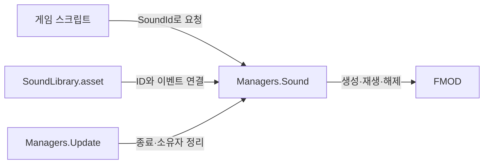

### FMOD 사운드 매니저

- 기능 설명: 협업자는 `Managers.Sound`에 사운드 ID와 위치 또는 오브젝트를 전달한다. FMOD 이벤트 생성, 재생 및 해제는 매니저가 처리한다.
- 동작 조건 및 처리 흐름: Managers가 승인된 Resources 설정을 로드해 SoundManager를 생성한다. 단발 효과음은 자연 종료하고 BGM은 매니저가 하나만 유지한다. Update는 종료된 재생과 소유자 수명을 정리한다.
- 구현 상태: 공개 재생 핸들과 미사용 지속 효과음 API를 제거하고 단발 효과음/BGM 중심으로 단순화했다. 기존 오브젝트별 정지와 음량 제어는 유지한다.
- 로그 규칙: Debug.Log 계열 안내 및 오류 메시지는 영어로 작성한다.
- 이름 변경 검증: SoundLibrary로 명칭과 Resources 로드 경로를 변경했다. Unity 재컴파일 성공, 새 경로의 에셋 로드, 기존 스크립트·에셋 GUID 및 FMOD 이벤트·Bus 설정 보존을 확인했다. 실제 소리 재생은 이번 작업에서 검증하지 않았다.

#### 관련 코드

| 파일 경로 | 클래스 / 메서드 | 역할 |
| --- | --- | --- |
| Assets/Scripts/Managers/SoundManager.cs | SoundManager | FMOD를 숨기는 공통 재생 API |
| Assets/Scripts/Managers/Managers.cs | InitializeSingleton, Update, ClearServices | 서비스 생성, 매 프레임 정리, 종료 처리 |
| Assets/Scripts/SoundSystem/SoundLibrary.cs | SoundLibrary / TryGetEvent | 사운드 ID와 FMOD 이벤트 연결 |
| Assets/Scripts/Enums/SoundId.cs | SoundId | 협업자가 선택하는 사운드 이름 |
| Assets/Resources/Sound/SoundLibrary.asset | SoundLibrary | 사운드 담당자가 편집하는 실제 설정 |

#### 연결 및 협업

- 연결된 기능: 기존 Managers, ResourceManager, FMOD RuntimeManager, BGM_Bus 및 SFX_Bus.
- 공유하는 코드 및 상태: 기존 Managers.Sound 접근을 유지한다. 이번 이름 변경 요청에 따라 공통 Managers의 로드 타입과 경로를 SoundLibrary로 함께 변경했다.
- 중복 또는 충돌 사항: 협업자에게 반환하던 재생 핸들과 지속 효과음 전용 API는 제거했다. 현재 저장소에는 해당 API를 사용하는 게임 스크립트가 없다. 다른 브랜치의 사용 여부는 미확인이다.
- 승인 필요 사항 및 결과: 사용자가 불필요한 재생 핸들 제거와 스크립트/문서 단순화를 요청했다. 사용자가 SoundCatalog를 SoundLibrary로 변경하도록 요청하여 클래스·스크립트·설정 에셋 및 Resources 로드 경로를 함께 변경한다. 기존 GUID와 FMOD 이벤트·Bus 설정을 유지한다. 새 Editor 폴더나 에셋 폴더는 만들지 않는다.

#### 새 씬에서 Unity Editor로 환경 구성하기

아래 절차는 같은 프로젝트 안에 새 씬을 추가하는 경우다. FMOD 플러그인과 기존 Library를 재사용한다. 씬을 만들고 Listener만 추가해도 소리가 자동 재생되지는 않으므로 마지막에 게임 코드의 재생 호출까지 연결한다.

##### 1. 씬 생성과 카메라 준비

1. `File > New Scene`에서 Empty 씬을 생성한다. 기존 씬에 미저장 변경이 있으면 먼저 직접 저장한다.
2. `File > Save As`로 프로젝트에서 합의한 씬 폴더에 저장한다. 씬 이름과 용도는 담당자가 정한다.
3. Hierarchy에서 우클릭하여 `Camera`를 생성하고 `Main Camera`로 이름을 지정한다. Inspector의 Tag를 `MainCamera`로 설정한다.
4. 위치 확인용 초기 배치로 Camera의 Position을 `(0, 1.6, -5)`, Rotation을 `(0, 0, 0)`으로 설정할 수 있다. 실제 게임에서는 플레이어가 사용하는 카메라의 위치와 방향을 따른다.
5. 소리 발생 오브젝트를 화면에서도 확인하려면 `GameObject > Light > Directional Light`로 조명을 추가한다.

##### 2. 청취 위치에 FMOD Listener 추가

1. Main Camera를 선택하고 Inspector의 `Add Component`에서 `FMOD Studio Listener`를 검색해 추가한다. 메뉴 분류는 `FMOD Studio > FMOD Studio Listener`다.
2. 단일 플레이어 씬에서는 의도한 Listener가 하나인지 확인한다. 플레이어 프리팹에 이미 있다면 카메라에 중복 추가하지 않는다.
3. Inspector의 Attenuation Object는 이 기본 구성에서는 비워 둔다. 그러면 해당 카메라 위치가 청취 위치가 된다.
4. Unity의 AudioListener는 FMOD StudioListener와 다른 컴포넌트다. AudioListener만 있는 상태로 FMOD 청취 구성이 완료됐다고 판단하지 않는다.

##### 3. 기존 FMOD 설정과 Library 확인

1. Unity 상단의 `FMOD > Edit Settings`를 열고 Source Type이 Studio 프로젝트를 사용하는지 확인한다.
2. 연결 파일이 `FMODProject/week06-blindblade/week06-blindblade.fspro`인지 확인한다. 새 씬을 추가하기 위해 프로젝트 연결이나 Bank 로딩 설정을 변경하지 않는다.
3. `FMOD > Event Browser`에서 `event:/Test/TestFootsteps`, `event:/Test/TestAmbience`가 보이는지 확인한다. 표시되지 않으면 Studio의 Bank 빌드 및 연결 경로부터 확인한다.
4. Project 창에서 `Assets/Resources/Sound/SoundLibrary.asset`을 선택한다. Inspector의 Events에 Footstep/Effect/발소리 이벤트와 Ambience/BGM/배경음 이벤트가 연결되어 있는지 확인한다.
5. Mixer의 Bgm Bus Path=`bus:/BGM_Bus`, Effect Bus Path=`bus:/SFX_Bus`를 확인한다. 이 에셋은 씬마다 복제하거나 Hierarchy에 배치하지 않는다.

##### 4. Managers 배치에 대한 선택

- 기본 구성에서는 Managers를 Hierarchy에 수동으로 추가할 필요가 없다. Play Mode에서 처음 `Managers.Sound`를 호출하면 기존 Managers를 찾고, 없으면 자동 생성한다.
- 자동 생성된 오브젝트는 `@ReusableManagers`로 표시되고 씬 전환 이후에도 유지된다. 호출할 때마다 새 매니저를 생성하지 않는다.
- 프로젝트의 기존 부트스트랩이나 프리팹이 이미 Managers를 제공한다면 그 구성을 그대로 사용한다. 새로운 씬마다 별도 매니저를 추가하지 않는다.
- SoundManager는 일반 C# 클래스라 Add Component로 부착하는 대상이 아니다. SoundLibrary.asset을 Managers의 Inspector에 드래그할 필요도 없다. 현재 코드가 Resources 경로에서 로드한다.
- 공통 Managers의 생성 코드와 `_sound.Update()`는 씬 준비를 이유로 수정하지 않는다. 변경이 필요하면 담당자와 합의한다.

##### 5. 발음체와 실제 재생 호출 연결

1. Hierarchy에서 `3D Object > Sphere`를 생성하고 소리 발생 위치를 나타내는 오브젝트로 사용한다. 초기 Position은 `(0, 1, 0)`으로 두면 위 카메라 정면에 놓인다. 실제 캐릭터가 있으면 해당 캐릭터를 사용한다.
2. Hierarchy에서 `Create Empty`로 씬의 오디오 시작을 담당할 오브젝트를 만든다.
3. 실제 게임에 씬 진입/BGM 실행 스크립트가 있다면 그 스크립트에 재생 호출을 연결한다. 처음부터 구성할 때는 아래처럼 일반 런타임 컴포넌트를 작성할 수 있다. 스크립트 저장 위치는 프로젝트 담당자와 합의한 게임 스크립트 폴더를 사용한다.
4. 예시를 사용할 경우 파일명과 클래스명을 모두 `SceneAudioController`로 작성하고 Unity 컴파일을 기다린다. 아래 코드는 문서 예시이며 저장소에 실제 파일을 추가한 상태가 아니다.

```csharp
using UnityEngine;

public class SceneAudioController : MonoBehaviour
{
    [Header("Sound")]
    [SerializeField] private SoundId _bgmId = SoundId.Ambience;
    [SerializeField] private SoundId _footstepId = SoundId.Footstep;
    [SerializeField] private GameObject _footstepSource;

    void Start()
    {
        PlayBgm();
    }

    void OnDisable()
    {
        if (Managers.IsInitialized)
            Managers.Sound.StopFor(gameObject);
    }

    /// <summary>
    /// Inspector의 _bgmId를 재생하고 이 오브젝트를 소유자로 지정한다.
    /// Play Mode의 활성 컴포넌트에서 Managers.Sound에 BGM 시작을 요청한다.
    /// </summary>
    [ContextMenu("Sound/Play BGM")]
    public void PlayBgm()
    {
        if (Application.isPlaying && isActiveAndEnabled)
            Managers.Sound.PlayBgm(_bgmId, gameObject);
    }

    /// <summary>
    /// Inspector의 _footstepId를 _footstepSource 위치에서 한 번 재생한다.
    /// Play Mode에서 부착 효과음을 요청하며 발음체 연결과 오류 처리는 매니저가 담당한다.
    /// </summary>
    [ContextMenu("Sound/Play Footstep")]
    public void PlayFootstep()
    {
        if (Application.isPlaying && isActiveAndEnabled)
            Managers.Sound.PlayAttached(_footstepId, _footstepSource);
    }

    /// <summary>
    /// 이 오브젝트가 소유한 BGM을 Fade Out 허용으로 정지한다.
    /// 초기화된 매니저에 정지를 요청하며 다른 소유자의 음악은 유지한다.
    /// </summary>
    [ContextMenu("Sound/Stop BGM")]
    public void StopBgm()
    {
        if (Application.isPlaying && Managers.IsInitialized)
            Managers.Sound.StopFor(gameObject, allowFadeOut: true);
    }
}
```

5. 빈 오브젝트를 선택하고 위 컴포넌트를 `Add Component` 또는 Project 창의 스크립트 드래그로 부착한다.
6. Inspector에서 Bgm Id=Ambience, Footstep Id=Footstep으로 지정하고 Footstep Source 필드에 Sphere 또는 실제 발음체를 드래그한다. EventReference를 이 컴포넌트에 할당하지 않는다.
7. 씬을 저장한다. 실제 게임의 발소리는 캐릭터 담당 코드에서 발 접촉 시점마다 `Managers.Sound.PlayAttached(SoundId.Footstep, gameObject)`를 호출하도록 연결한다. 위 예시는 씬 진입 BGM과 수동 호출을 보여주며 캐릭터 이동·애니메이션을 구현하지 않는다.
8. 동일한 소리에 별도의 AudioSource나 StudioEventEmitter를 추가해 자동 재생을 켜면 중복 재생될 수 있다. 이 매니저 호출 방식에서 추가 재생 컴포넌트는 필요하지 않다.

##### 6. Play Mode에서 확인

1. Play를 누르면 예시 컴포넌트의 Start가 BGM을 재생한다. Managers 오브젝트가 생성되고 Console에 오류가 없는지 확인한다.
2. 해당 컴포넌트 오른쪽 위 메뉴에서 `Sound > Stop BGM`을 선택한다. 발소리를 확인할 때 먼저 음악을 정지한다.
3. 같은 메뉴의 `Sound > Play Footstep`으로 발소리를 한 번 재생한다. 메뉴 호출은 Play Mode에서 수행한다. Game View의 키보드 입력은 이 예시에서 사용하지 않는다.
4. 발음체를 카메라 왼쪽/오른쪽으로 옮긴 뒤 다시 호출하고, 가까운 거리와 먼 거리에서 크기를 비교한다. 카메라를 회전했을 때 청취 방향도 바뀌는지 확인한다.
5. `Sound > Play BGM`으로 음악을 다시 시작하고 끝 지점 이후에도 반복되는지 확인한다. 반복은 Studio 이벤트에 설정되어 있어야 한다.
6. Play Mode를 종료한다. Play Mode 중 변경한 Transform이나 연결 값이 씬에 저장됐다고 가정하지 않는다. 필요한 최종 배치는 Edit Mode에서 설정하고 다시 저장한다.
7. 이후 실제 게임 행동에 연결한 상태에서 [수동 검증 절차](FMOD_사운드_검증.md)의 나머지 항목을 수행한다.

새 씬 구성의 완료 기준은 카메라/Listener, 기존 Library, Managers 실행 주체, 실제 재생 호출이 모두 연결된 상태다. 현재 프로젝트에서 새 게임 씬을 이 절차대로 생성·실행한 결과는 별도 검증 전까지 미확인으로 기록한다.

문서의 SceneAudioController 예시는 현재 Unity의 Pipeline에서 컴파일만 검증했으며 성공했다. Inspector에서 할당하는 Footstep Source 필드에 대한 CS0649 경고가 있었으므로 위 드래그 연결 단계를 빠뜨리지 않는다. 예시 코드를 실행하거나 새 씬과 스크립트를 저장소에 생성하지 않았다.

#### 협업자가 알아야 할 기본 사용법

`using FMODUnity` 또는 FMOD 이벤트 경로를 작성할 필요가 없다. Play Mode의 게임 코드에서 다음처럼 호출한다.

| 원하는 동작 | 호출 |
| --- | --- |
| 지정 위치에서 효과음 1회 | `Play(id, position)` |
| 이동하는 오브젝트에서 효과음 1회 | `PlayAttached(id, gameObject)` |
| BGM 재생 | `PlayBgm(id)` |
| BGM 정지 | `StopBgm()` |
| 이 오브젝트의 소리만 정지 | `StopFor(gameObject)` |
| 모든 효과음 정지 | `StopEffects()` |

현재 사용 가능한 ID는 `SoundId.Footstep`(효과음)과 `SoundId.Ambience`(BGM)다.

```csharp
// 발이 바닥에 닿을 때 한 번 호출한다.
Managers.Sound.PlayAttached(SoundId.Footstep, gameObject);

// 고정된 위치에서 발생하는 단발음에 사용한다.
Managers.Sound.Play(SoundId.Footstep, hitPosition);

// BGM을 재생하고 필요한 시점에 정지한다.
Managers.Sound.PlayBgm(SoundId.Ambience);
Managers.Sound.StopBgm();
```

발소리와 짧은 공격음은 한 번 호출한 뒤 자연스럽게 끝나게 둔다. 매 프레임 호출하지 않는다. 적이 이동을 멈추면 다음 발걸음 호출을 중단한다. 공격음이 시작된다는 이유로 이미 재생 중인 발소리를 중간에 정지하지 않는다.

#### 음량과 정리

```csharp
// 옵션의 공통 음량: 0은 무음, 1은 Studio에서 설정한 기본 음량.
Managers.Sound.BgmVolume = 0.5f;
Managers.Sound.EffectVolume = 0.8f;

// 이 호출 한 번의 음량 배율: 2는 약 +6dB.
Managers.Sound.PlayAttached(SoundId.Footstep, gameObject, volume: 2f);

// 비활성화 또는 기능 종료 시 이 오브젝트의 재생만 정리한다.
if (Managers.IsInitialized)
    Managers.Sound.StopFor(gameObject);

// 전역 효과음 정리. BGM은 유지된다.
Managers.Sound.StopEffects();

// BGM과 효과음의 전역 정리.
Managers.Sound.Clear();
```

- PlayAttached의 source는 소유자이기도 하다. 소유자가 비활성화되거나 파괴되면 다음 매니저 Update에서 해당 소리를 즉시 정지한다.
- Play는 위치가 고정되어 있다. 필요하면 `Play(id, position, owner: gameObject)`로 소유자만 지정할 수 있으며, 오브젝트를 따라 이동하지는 않는다.
- PlayBgm도 선택적으로 `owner: gameObject`를 받는다. 소유자 없는 BGM은 직접 정지할 때까지 유지되고, 같은 BGM의 마지막 요청자가 소유권을 받는다.
- StopFor는 지정한 소유자의 모든 효과음과 BGM을 정지한다. 일반 발걸음/공격 전환용이 아닌 오브젝트 수명 정리에 사용한다. 다른 소유자 및 소유자 없는 재생은 유지한다.
- StopBgm의 기본은 Fade Out 허용이다. 실제 길이는 FMOD Studio의 Release 설정에 따른다. `StopBgm(allowFadeOut: false)`는 즉시 정지한다.
- Bus 옵션 음량은 해당 Bus의 모든 이벤트에 적용된다. 기본 배율은 1이다. 사용자 설정의 저장과 복원은 옵션 담당 코드에서 처리한다.

#### API의 결과와 제한

- Play, PlayAttached, PlayBgm은 성공하면 true를 반환한다. 이벤트 누락, 사운드 종류 불일치, 비활성 발음체 등은 false와 영어 경고로 전달한다.
- Play와 PlayAttached에는 단발 이벤트만 등록한다. 루프 효과음을 이 API로 재생하면 거부한다.
- BGM 반복은 Studio의 Loop Region을 사용한다. 같은 BGM은 중복 생성하지 않으며, 페이드 정지 중 같은 ID의 재생 요청은 false를 반환한다.
- BGM을 다른 곡으로 전환할 때 이전 음악은 즉시 정지한다. 크로스페이드는 지원하지 않는다.
- 현재는 BGM 외의 지속 효과음, 재생 한 건의 일시정지 및 파라미터 제어 API를 제공하지 않는다. 실제 충전음이나 기계음 기능이 필요할 때 구체적인 요구에 맞춰 추가한다.
- `Stop(SoundType)`은 기존 호출과의 호환을 위해 유지한다. 새 호출부는 의미가 드러나는 StopBgm 또는 StopEffects를 사용한다.

#### 사운드 담당자의 등록 방법

SoundId는 게임 코드가 사용하는 이름이고, SoundLibrary는 그 이름에 실제 FMOD 이벤트를 연결하는 설정이다. ID만 추가하거나 Studio 이벤트만 제작해서는 매니저 재생이 완성되지 않는다.

1. FMOD Studio에서 이벤트를 제작하고 적절한 Bus/Bank에 연결한 뒤 빌드한다. 실제 프로젝트 경로는 `FMODProject/week06-blindblade/week06-blindblade.fspro`다.
2. `Assets/Scripts/Enums/SoundId.cs`의 enum에 이름과 고유 숫자를 추가한다. None=0은 재생에 사용하지 않는다. 이미 저장한 ID의 숫자는 변경하거나 다른 소리에 재사용하지 않는다.
3. Unity 컴파일을 기다린 뒤 Project에서 기존 `Assets/Resources/Sound/SoundLibrary.asset`을 선택한다. 추가 사운드마다 Library 에셋을 새로 만들지 않는다.
4. Inspector의 Events 배열에 항목을 하나 추가하고 Id에 새 enum 값, Type에 Effect 또는 BGM, Event에 FMOD Event Browser에서 고른 이벤트를 지정한다.
5. Effect는 단발 이벤트에 연결하고 Play/PlayAttached로 호출한다. BGM은 2D 이벤트에 연결하고 PlayBgm으로 호출한다. 음악을 반복하려면 Studio에서 Loop Region을 설정한다.
6. None, 중복 Id, 비어 있는 Event를 확인하고 에셋을 저장한다. 중복은 임의로 첫 항목을 재생하지 않고 오류로 거부한다.
7. 협업자에게 사용할 SoundId와 호출 시점을 전달한다. [수동 검증 절차](FMOD_사운드_검증.md)를 수행한 뒤 결과를 기록한다.

예를 들어 새로운 타격음을 추가한다면 아래처럼 명시적인 숫자를 배정한다. SwordHit는 등록 방법을 보여주는 예시이며 현재 enum에 존재하지 않는다.

```csharp
public enum SoundId
{
    None = 0,
    Footstep = 1,
    Ambience = 2,
    SwordSwing = 3,
    SwordHit = 4,
}
```

그다음 Library에 Id=SwordHit, Type=Effect, Event=실제로 제작한 단발 타격음 이벤트를 연결한다. 등록까지 끝난 뒤에만 `Managers.Sound.Play(SoundId.SwordHit, hitPosition)`을 사용한다.

Library의 Mixer 설정은 Bgm Bus Path=`bus:/BGM_Bus`, Effect Bus Path=`bus:/SFX_Bus`다. Studio의 실제 Bus 경로가 바뀌면 이 값도 갱신한다. Bank 이름과 Bus 경로는 다른 개념이다.

자동 로드 경로는 `Sound/SoundLibrary`로 고정되어 있다. 에셋을 Resources 밖으로 이동하거나 이름을 바꾸면 Managers가 찾지 못한다. 경로를 바꿔야 한다면 공통 Managers 담당자와 먼저 합의한다.

재생되지 않을 때는 영어 Console 경고를 확인한다. 등록 누락은 `No event registered for SoundId`, Library 로드 누락은 `SoundLibrary is not assigned`, 종류 불일치는 `playback API does not match`, Bank/Bus 누락은 `not found in loaded banks`로 안내된다.

| ID | Type | 현재 FMOD 이벤트 |
| --- | --- | --- |
| Footstep=1 | Effect | event:/Footsteps |
| Ambience=2 | BGM | event:/Test/TestAmbience |
| SwordSwing=3 | Effect | event:/SwordSwing |
| SwordHit=4 | Effect | event:/SwordHit |

#### 내부 구조를 이해하고 싶을 때



- SoundManager는 일반 C# 클래스라 Unity가 Update를 자동 호출하지 않는다. Managers가 대신 호출한다.
- 내부 ActiveEffect는 단발음의 인스턴스와 소유자만 기록하는 private 데이터다. 별도 스크립트나 협업자가 다루는 핸들이 아니다.
- 단발음은 시작 직후 해제를 요청하여 자연 종료 시 FMOD가 자원을 반환한다. Update는 종료된 항목을 내부 목록에서 제거한다.
- 실제 오디오 믹싱과 부착 발음체의 위치 갱신은 FMOD RuntimeManager가 수행한다. 매니저 Update는 소리를 반복 재생하지 않는다.
- Managers는 PoolManager, ResourceManager, SoundManager, SceneManagerEx를 보유하며 씬 전환 시 유지된다. ResourceManager는 Library만 로드하며 FMOD 음원은 Unity AudioClip Pool을 사용하지 않는다.
- SoundLibrary.cs는 SoundSystem 폴더에 있고 실제 설정 에셋은 Resources/Sound에 있다. 기존 호출은 유지하며 설정 에셋 이름과 로드 경로를 SoundLibrary로 변경했다.

#### 공통 Managers의 Update 호출에 대한 협업 규칙

- 현재 `_sound.Update()`는 테스트 코드가 아닌 사운드 서비스의 수명 정리 호출이다. 소유자의 비활성화/파괴를 감지해 재생을 정지하고, 종료된 효과음 항목 및 BGM 상태를 정리한다.
- FMOD 재생과 부착 위치 갱신 자체에는 이 호출이 필요하지 않다. 단발음의 FMOD 자원은 시작 시 release를 요청했으므로 자연 종료한다.
- 다만 이 호출만 삭제하면 소유자 자동 정지와 종료 목록의 매 프레임 정리 보장이 사라진다. 효과음 목록은 다음 Play/PlayAttached 요청 또는 Clear에서만 정리되며, 소유자 있는 BGM도 명시적 StopBgm/StopFor/Clear 없이는 자동 정지되지 않을 수 있다.
- 따라서 현재 동작을 유지하려면 주기적 정리 호출이 필요하다. 반드시 공통 Managers에 있어야 하는 것은 아니며 사운드 전용 실행 컴포넌트로 옮길 수 있다. 그 변경은 공통 Managers 담당자의 승인과 대체 호출 주체 설계를 먼저 합의해야 한다.
- 이번 작업에서는 해당 호출을 제거하거나 다른 컴포넌트를 추가하지 않았다. Managers와 SoundManager는 그대로 유지한다.

#### 검증 결과

- Unity 컴파일 성공, Console 오류 0건. 삭제한 공개 재생 핸들 타입과 지속음 전용 API가 컴파일된 어셈블리에 없는 것을 확인했다.
- 이전 실행 검증에서는 BGM과 발소리가 매니저를 통해 정상 재생됐고 같은 BGM의 중복 생성이 방지됐다. 이는 실제 게임의 행동별 호출까지 검증됐다는 의미는 아니다.
- 발음체 이동 후 FMOD 위치가 x=2로 갱신됐다. 발소리가 자연 종료한 뒤 인스턴스가 해제되고 내부 목록이 0개가 됐다.
- StopFor(A)는 A의 효과음만 정지하고 B의 재생을 유지했다. 별도 재생 스크립트 없는 소유자의 비활성화도 매니저 Update에서 정리됐다.
- 개별 재생 배율 2와 SFX Bus 옵션 음량 0.7이 적용됐다. StopEffects는 효과음을 정지하면서 BGM을 유지했다. Clear 이후 다시 재생할 수 있었다.
- 검증 중 사용한 런타임 음량, 발음체 위치 및 실행 상태를 복구했다. 일회성 관찰 스크립트는 제거했으며 Editor 폴더나 테스트 프레임워크 코드는 추가하지 않았다.
- 현재 전용 검증 코드와 씬은 삭제된 상태다. 실제 게임의 재생 호출부와 StudioListener를 준비한 뒤 [수동 검증 절차](FMOD_사운드_검증.md)를 사용한다.

#### MainMap 플레이어 발소리 연결

- MainMapSession의 OnEnable/OnDisable에서 PlayerController.FootstepEmitted 구독을 연결·해제한다. 주석 처리되었던 재생 연결을 복구했다.
- 착지 시 Managers.Sound.PlayAttached(SoundId.Footstep, _player.gameObject, step.NoiseStrength)를 호출한다. FMOD 인스턴스는 재생 중 플레이어 위치를 따라가며 일반·가드 음량 배율은 0.6, 충전 보행은 0.2다.
- Player Camera의 활성 StudioListener 하나와 기존 Studio 프로젝트·Master/BGM/SFX Bank 자동 로딩을 확인했다. 중복 Listener나 별도 Managers를 추가하지 않았다.
- SoundLibrary의 기존 event:/Test/TestFootsteps 연결을 유지한다. 새 event:/Footsteps도 Event Browser에 있지만 이번 설정에서 선택하지 않았다. 사용자가 편집한 Studio 음원·이벤트·Bank 파일은 수정하거나 커밋에 포함하지 않았다.
- Unity 컴파일 성공. 현재 씬의 Step Move Duration 0.4초와 Step Pause Duration 0.08초를 사용한 Play 검증에서 실제 착지 1회 → FMOD 인스턴스 1개, PLAYING, 3D, 음량 0.6, WASAPI 출력 상태를 확인했다. 체감 음질·크기의 청취 검증은 미확인이다.
- 런타임 검증 후 Play를 종료했다. 테스트 코드·씬 오브젝트를 추가하지 않았다.

- MainMap 이동 감각: SetFootstepOnlyOwner(GameObject)는 지정 플레이어의 Footstep, SwordSwing, SwordHit을 허용하고 기존 효과음을 정지하며 BGM을 음소거한다. null로 제한을 해제한다. 이동 상태 판단과 해제는 MainMapSession이 소유하며 옵션 Bus 음량은 변경하지 않는다. 직접 FMOD/AudioSource 호출에는 적용되지 않는다.

- 2026-10-10: 사용자 요청으로 SoundLibrary의 Footstep Event 경로와 GUID를 event:/Footsteps로 변경했다. 기존 테스트 이벤트 대신 Footsteps_Wood_Walk 음원을 포함한 새 이벤트를 사용한다. Unity Play에서 Managers.Sound.PlayAttached 호출 성공과 실제 이벤트 경로 event:/Footsteps, PLAYING 상태를 확인했다. Studio 음원·Bank의 기존 사용자 변경은 커밋에 포함하지 않았다.

#### 복도 검 휘두르기 및 명중음

- Assets/Scripts/Player/PlayerCombatAudio.cs를 StraightCorridor의 Player에 추가했다. PlayerController.ActionEvent를 구독하여 일반 공격 AttackStarted 또는 발도 SlashStarted에 SwordSwing을, HitConfirmed에 SwordHit을 재생한다. ActionId를 기록하여 각 소리를 행동당 한 번만 요청한다. 헛스윙은 명중음이 없다.
- PlayAttached로 플레이어에 소리를 부착한다. 이동 중에도 해당 플레이어의 두 전투음은 허용한다. 적의 다른 소리 및 BGM에 대한 기존 이동 제한은 유지한다.
- 새 FMOD 이벤트 event:/SwordSwing 및 event:/SwordHit은 Combat Bank와 SFX_Bus에 연결한 단발음이다. 원본은 FMODProject/week06-blindblade/Assets/Combat/SwordSwing.wav 및 SwordHit.wav이며 이번 작업에서 생성한 임시 음원이다. 기존 발소리 음원은 교체하지 않는다.
- 음원 교체: FMOD Studio에서 위 이벤트의 Single Instrument 음원을 바꾸고 Desktop Bank를 Build한다. Unity FMOD Bank Source는 기존 FMODProject Build/Desktop이다. SoundLibrary의 SwordSwing=3, SwordHit=4 연결과 FMOD Settings의 Combat 자동 로드를 사용한다. PlayerCombatAudio의 Volume 기본값은 0.8이다.
- 검증: 실제 RequestNormalAttack → NotifyNormalAttackImpact 호출에서 휘두르기 1개, 성공 명중 후 총 2개 FMOD 인스턴스 생성과 적 사망을 확인했다. 이동 사운드 제한 상태에서도 성공했다. 헛스윙 시 인스턴스는 1개였다. 재시작 직후 체력 100 및 감각 준비 상태를 확인했고 플레이어 선제 명중 후 비치명 피해에는 GameOver가 발생하지 않았다. Unity 컴파일 성공. 체감 음질과 사용자의 스피커 출력 청취는 미확인이다.
