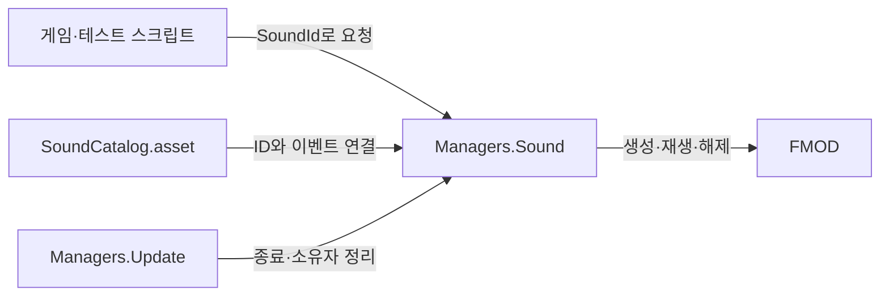

### FMOD 사운드 매니저

- 기능 설명: 협업자는 `Managers.Sound`에 사운드 ID와 위치 또는 오브젝트를 전달한다. FMOD 이벤트 생성, 재생 및 해제는 매니저가 처리한다.
- 동작 조건 및 처리 흐름: Managers가 승인된 Resources 설정을 로드해 SoundManager를 생성한다. 단발 효과음은 자연 종료하고 BGM은 매니저가 하나만 유지한다. Update는 종료된 재생과 소유자 수명을 정리한다.
- 구현 상태: 공개 재생 핸들과 미사용 지속 효과음 API를 제거하고 단발 효과음/BGM 중심으로 단순화했다. 기존 오브젝트별 정지와 음량 제어는 유지한다.
- 로그 규칙: Debug.Log 계열 안내 및 오류 메시지는 영어로 작성한다.

#### 관련 코드

| 파일 경로 | 클래스 / 메서드 | 역할 |
| --- | --- | --- |
| Assets/Scripts/Managers/SoundManager.cs | SoundManager | FMOD를 숨기는 공통 재생 API |
| Assets/Scripts/Managers/Managers.cs | InitializeSingleton, Update, ClearServices | 서비스 생성, 매 프레임 정리, 종료 처리 |
| Assets/Scripts/SoundSystem/SoundCatalog.cs | SoundCatalog / TryGetEvent | 사운드 ID와 FMOD 이벤트 연결 |
| Assets/Scripts/Enums/SoundId.cs | SoundId | 협업자가 선택하는 사운드 이름 |
| Assets/Resources/Sound/SoundCatalog.asset | SoundCatalog | 사운드 담당자가 편집하는 실제 설정 |

#### 연결 및 협업

- 연결된 기능: 기존 Managers, ResourceManager, FMOD RuntimeManager, BGM_Bus 및 SFX_Bus.
- 공유하는 코드 및 상태: 기존 Managers.Sound 접근과 SoundTest 컴포넌트의 호출을 유지한다. 현재 작업에서 기존 씬, Material, FMOD 설정 및 Bank는 변경하지 않는다.
- 중복 또는 충돌 사항: 협업자에게 반환하던 재생 핸들과 지속 효과음 전용 API는 제거했다. 현재 저장소에는 해당 API를 사용하는 게임 스크립트가 없다. 다른 브랜치의 사용 여부는 미확인이다.
- 승인 필요 사항 및 결과: 사용자가 불필요한 재생 핸들 제거와 스크립트/문서 단순화를 요청했다. 기존에 승인한 Catalog 에셋 경로를 유지한다. 새 Editor 폴더나 에셋 폴더는 만들지 않는다.

#### 협업자가 알아야 할 기본 사용법

`using FMODUnity` 또는 FMOD 이벤트 경로를 작성할 필요가 없다. Play Mode의 게임 코드에서 다음처럼 호출한다.

| 원하는 동작 | 호출 |
| --- | --- |
| 지정 위치에서 효과음 1회 | `Play(id, position)` |
| 이동하는 오브젝트에서 효과음 1회 | `PlayAttached(id, gameObject)` |
| BGM 재생 | `PlayBgm(id)` |
| BGM 정지 | `StopBgm()` |
| 이 오브젝트의 소리만 정지 | `StopFor(gameObject)` |
| 모든 효과음 정지 | `StopEffects()` |

현재 사용 가능한 ID는 `SoundId.Footstep`(효과음)과 `SoundId.Ambience`(BGM)다.

```csharp
// 발이 바닥에 닿을 때 한 번 호출한다.
Managers.Sound.PlayAttached(SoundId.Footstep, gameObject);

// 고정된 위치에서 발생하는 단발음에 사용한다.
Managers.Sound.Play(SoundId.Footstep, hitPosition);

// BGM을 재생하고 필요한 시점에 정지한다.
Managers.Sound.PlayBgm(SoundId.Ambience);
Managers.Sound.StopBgm();
```

발소리와 짧은 공격음은 한 번 호출한 뒤 자연스럽게 끝나게 둔다. 매 프레임 호출하지 않는다. 적이 이동을 멈추면 다음 발걸음 호출을 중단한다. 공격음이 시작된다는 이유로 이미 재생 중인 발소리를 중간에 정지하지 않는다.

#### 음량과 정리

```csharp
// 옵션의 공통 음량: 0은 무음, 1은 Studio에서 설정한 기본 음량.
Managers.Sound.BgmVolume = 0.5f;
Managers.Sound.EffectVolume = 0.8f;

// 이 호출 한 번의 음량 배율: 2는 약 +6dB.
Managers.Sound.PlayAttached(SoundId.Footstep, gameObject, volume: 2f);

// 비활성화 또는 기능 종료 시 이 오브젝트의 재생만 정리한다.
if (Managers.IsInitialized)
    Managers.Sound.StopFor(gameObject);

// 전역 효과음 정리. BGM은 유지된다.
Managers.Sound.StopEffects();

// BGM과 효과음의 전역 정리.
Managers.Sound.Clear();
```

- PlayAttached의 source는 소유자이기도 하다. 소유자가 비활성화되거나 파괴되면 다음 매니저 Update에서 해당 소리를 즉시 정지한다.
- Play는 위치가 고정되어 있다. 필요하면 `Play(id, position, owner: gameObject)`로 소유자만 지정할 수 있으며, 오브젝트를 따라 이동하지는 않는다.
- PlayBgm도 선택적으로 `owner: gameObject`를 받는다. 소유자 없는 BGM은 직접 정지할 때까지 유지되고, 같은 BGM의 마지막 요청자가 소유권을 받는다.
- StopFor는 지정한 소유자의 모든 효과음과 BGM을 정지한다. 일반 발걸음/공격 전환용이 아닌 오브젝트 수명 정리에 사용한다. 다른 소유자 및 소유자 없는 재생은 유지한다.
- StopBgm의 기본은 Fade Out 허용이다. 실제 길이는 FMOD Studio의 Release 설정에 따른다. `StopBgm(allowFadeOut: false)`는 즉시 정지한다.
- Bus 옵션 음량은 해당 Bus의 모든 이벤트에 적용된다. 기본 배율은 1이다. 사용자 설정의 저장과 복원은 옵션 담당 코드에서 처리한다.

#### API의 결과와 제한

- Play, PlayAttached, PlayBgm은 성공하면 true를 반환한다. 이벤트 누락, 사운드 종류 불일치, 비활성 발음체 등은 false와 영어 경고로 전달한다.
- Play와 PlayAttached에는 단발 이벤트만 등록한다. 루프 효과음을 이 API로 재생하면 거부한다.
- BGM 반복은 Studio의 Loop Region을 사용한다. 같은 BGM은 중복 생성하지 않으며, 페이드 정지 중 같은 ID의 재생 요청은 false를 반환한다.
- BGM을 다른 곡으로 전환할 때 이전 음악은 즉시 정지한다. 크로스페이드는 지원하지 않는다.
- 현재는 BGM 외의 지속 효과음, 재생 한 건의 일시정지 및 파라미터 제어 API를 제공하지 않는다. 실제 충전음이나 기계음 기능이 필요할 때 구체적인 요구에 맞춰 추가한다.
- `Stop(SoundType)`은 기존 호출과의 호환을 위해 유지한다. 새 호출부는 의미가 드러나는 StopBgm 또는 StopEffects를 사용한다.

#### 사운드 담당자의 등록 방법

1. FMOD Studio에서 이벤트를 제작하고 적절한 Bus/Bank에 연결한 뒤 빌드한다.
2. SoundId에 고유 숫자의 항목을 추가한다. 기존 숫자는 변경하지 않는다.
3. 승인된 SoundCatalog.asset의 Events에 Id, Type(BGM/Effect), Event를 등록한다. None 또는 중복 ID는 사용하지 않는다.
4. 협업자에게 사용할 SoundId와 호출 시점만 전달한다. FMOD Bus 경로가 바뀌면 Catalog 설정도 갱신한다.

| ID | Type | 현재 FMOD 이벤트 |
| --- | --- | --- |
| Footstep=1 | Effect | event:/Test/TestFootsteps |
| Ambience=2 | BGM | event:/Test/TestAmbience |

#### 내부 구조를 이해하고 싶을 때



- SoundManager는 일반 C# 클래스라 Unity가 Update를 자동 호출하지 않는다. Managers가 대신 호출한다.
- 내부 ActiveEffect는 단발음의 인스턴스와 소유자만 기록하는 private 데이터다. 별도 스크립트나 협업자가 다루는 핸들이 아니다.
- 단발음은 시작 직후 해제를 요청하여 자연 종료 시 FMOD가 자원을 반환한다. Update는 종료된 항목을 내부 목록에서 제거한다.
- 실제 오디오 믹싱과 부착 발음체의 위치 갱신은 FMOD RuntimeManager가 수행한다. 매니저 Update는 소리를 반복 재생하지 않는다.
- Managers는 PoolManager, ResourceManager, SoundManager, SceneManagerEx를 보유하며 씬 전환 시 유지된다. ResourceManager는 Catalog만 로드하며 FMOD 음원은 Unity AudioClip Pool을 사용하지 않는다.
- SoundCatalog.cs는 SoundSystem 폴더에 있고 실제 설정 에셋은 Resources/Sound에 있다. 기존 호출과 설정 에셋 경로는 유지한다.

#### 검증 결과

- Unity 컴파일 성공, Console 오류 0건. 삭제한 공개 재생 핸들 타입과 지속음 전용 API가 컴파일된 어셈블리에 없는 것을 확인했다.
- 기존 테스트 씬의 BGM과 발소리가 매니저를 통해 정상 재생됐다. 같은 BGM의 중복 생성과 같은 프레임의 중복 발걸음 호출이 방지됐다.
- 발음체 이동 후 FMOD 위치가 x=2로 갱신됐다. 발소리가 자연 종료한 뒤 인스턴스가 해제되고 내부 목록이 0개가 됐다.
- StopFor(A)는 A의 효과음만 정지하고 B의 재생을 유지했다. 별도 재생 스크립트 없는 소유자의 비활성화도 매니저 Update에서 정리됐다.
- 개별 재생 배율 2와 SFX Bus 옵션 음량 0.7이 적용됐다. StopEffects는 효과음을 정지하면서 BGM을 유지했다. Clear 이후 다시 재생할 수 있었다.
- 검증 중 사용한 런타임 음량, 발음체 위치 및 실행 상태를 복구했다. 일회성 관찰 스크립트는 제거했으며 Editor 폴더나 테스트 프레임워크 코드는 추가하지 않았다.
