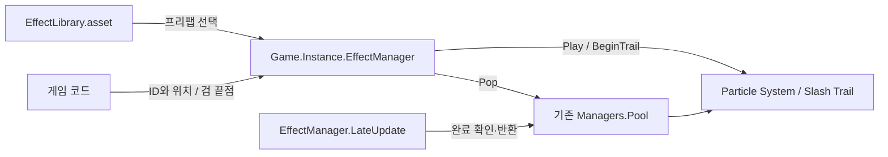

### 이펙트 시스템

- 기능 설명: 협업자는 접촉점에 Hit를 요청하거나 검 양 끝점으로 Slash Trail을 시작한다. 파티클 생성·완료·풀 반환은 공통 매니저가 처리한다.
- 동작 조건 및 처리 흐름: Game이 EffectManager를 생성하고 Library의 풀을 준비한다. 단발은 ParticleSystem.Play(true)로 자식까지 재생하고 IsAlive(true)로 완료를 확인한다. Trail은 기록 종료 후 잔상이 사라지면 반환한다.
- 구현 상태: 원형 Hit·네이티브 단발 파티클·Slash Trail 및 세션 관리 구현 완료. 현재 코드의 컴파일과 정상 재생·잘못된 요청 안내·비활성 검 정리·세션 재시작을 확인했다.
- 로그 규칙: 안내 및 오류는 SoundManager처럼 영어 Console 메시지로 기록한다.

#### 협업자가 알아야 할 기본 사용법

게임 코드에서 다음처럼 호출한다. 프리팹·셰이더·풀 객체를 직접 다룰 필요는 없다.

```csharp
var effects = Game.Instance.EffectManager;

// 실제 접촉을 확정한 시점에 한 번 호출한다.
effects.PlayHit(contactPosition);

// 선택한 단발 효과를 고정 위치에서 한 번 재생한다.
effects.Play(EffectId.BloodHit, position);

// 실제 베기 구간의 시작과 끝에서 호출한다.
int trailHandle = effects.BeginTrail(bladeBase, bladeTip);
effects.EndTrail(trailHandle);
```

| 원하는 동작 | 호출과 반환 |
| --- | --- |
| 접촉점에 공용 원형 Hit | PlayHit(position), 성공 bool |
| 등록한 단발 효과 | Play(id, position), 성공 bool |
| 회전을 지정한 단발 효과 | Play(id, position, rotation), 성공 bool |
| 검 Trail 시작 | BeginTrail(bladeBase, bladeTip), 요청 번호 / 실패 0 |
| Trail 기록 종료·자연 페이드 | EndTrail(handle), 유효한 요청 bool |
| 공격 취소·무기 교체의 즉시 정리 | StopTrail(handle), 유효한 요청 bool |
| 세션 종료 / 다시 시작 | EndSession() / BeginSession() |

| ID | 고유 숫자 | 현재 프리팹 |
| --- | --- | --- |
| None | 0 | 재생에 사용하지 않음 |
| BloodHit | 1 | Assets/Resources/Prefabs/Effects/BloodHit.prefab |
| SwordClash | 2 | Assets/Resources/Prefabs/Effects/SwordClash.prefab, 공용 원형 Hit |
| SwordSlashTrail | 3 | Assets/Resources/Prefabs/Effects/SwordSlashTrail.prefab |

- Hit는 접촉점만 받는다. 표면 법선·검 이동 방향·재질·대상 종류는 전달하지 않는다. 섬광·링은 View Billboard, 불꽃은 Sphere Shape로 같은 원형 표현을 사용한다.
- 단발은 한 번 요청한 뒤 자연 종료하게 둔다. 매 프레임 호출하면 그만큼 객체가 생성되고 풀도 증가한다.
- Trail 요청 번호는 공격별 필드에 보관한다. 끝에서는 EndTrail, 취소·무기 교체·호출자 비활성화에서는 StopTrail을 호출하고 보관 번호를 0으로 바꾼다.
- 검 끝점은 활성 상태여야 한다. 파괴·비활성화되면 새 기록을 중단하고 기존 잔상의 수명이 끝난 뒤 반환한다. 명시적 StopTrail은 잔상까지 즉시 제거한다.
- None·미등록 ID·잘못된 종류·미준비 세션은 실패 결과와 Console 안내로 확인한다. IsReady=true만으로 ID나 입력이 유효하다고 보장하지 않으므로 반환값도 확인한다.
- 효과 요청 성공 여부를 피해·가드·소리 판정 결과로 사용하지 않는다.

#### 담당자별 연결과 지원 범위

이 시스템은 월드 공간의 전투 이펙트 재생 서비스이다. 협업자는 요청 시점을 결정하고, 생성·재생 완료·풀 반환은 EffectManager가 담당한다.

| 담당자 | 호출 | 담당자가 연결할 내용 |
| --- | --- | --- |
| 플레이어 | BeginTrail·EndTrail·StopTrail | 실제 검 양 끝점 Transform, 베기 시작·종료·취소 콜백, 공격별 핸들 |
| 적 | PlayHit, Play(BloodHit, position) | 확정된 접촉점과 한 번의 재생 요청. 검을 쓰는 적은 동일한 Trail API 사용 |
| UI | 필요하면 Play·PlayHit로 월드 효과 요청 | 월드 위치를 아는 사건의 요청만 가능. Canvas 버튼 반짝임·화면 피격 테두리·RectTransform 추적은 지원하지 않음 |
| 게임 세션 | BeginSession·EndSession | 전체 세션 관리. 개별 캐릭터는 전체 EndSession을 호출하지 않음 |
| 이펙트 | 프리팹·EffectLibrary 등록 | 외형 제작, ID·프리팹 연결, 파티클 설정 |

- 서비스 참조는 Start 또는 Game.Awake 이후에 가져온다. 요청 성공 여부는 bool, Trail 시작 실패는 핸들 0으로 확인한다.
- position은 월드 좌표이다. 화면 픽셀 좌표나 Canvas 로컬 좌표를 그대로 전달하지 않는다. UI 좌표 변환·표시 순서·UI 전용 렌더링은 자동 처리하지 않는다.
- 한 사건의 Hit 호출 담당자를 하나로 정한다. 피해 판정 담당자가 요청한다면 공격자와 피해자가 같은 사건에서 모두 PlayHit를 호출하지 않는다.
- Trail 핸들을 공격별로 보관한다. 정상 종료 시 EndTrail, 취소·무기 교체·호출자 비활성화 시 StopTrail을 호출하고 보관한 핸들을 0으로 바꾼다.
- 호출자는 효과 객체를 직접 Destroy하거나 풀에 반환하지 않는다. 재생 실패가 피해·가드 판정을 취소하는 조건이 되지 않게 한다.
- 실제 충돌·피해 판정·Animation Event 수신 메서드는 각 담당자가 연결한다. 현재 시스템에 자동 연결돼 있다고 가정하지 않는다.

#### 새 씬에서 Unity Editor로 환경 구성하기

##### 1. 카메라와 재생 위치 준비

1. 기존 씬·플레이어 카메라가 있으면 해당 구성을 사용한다. 새 씬에서는 Camera를 만들고 표시할 접촉점이 시야 안에 있도록 배치한다.
2. Hit 자체는 Unlit 표현이라 별도 조명이 필수는 아니다. 기존 프로젝트의 URP 설정을 사용하며 새 씬을 위해 렌더 파이프라인 설정을 변경하지 않는다.
3. 원형 Hit 확인에는 월드 접촉점을 나타내는 빈 Transform 하나면 된다. Trail 확인에는 실제 검 밑점과 끝점 Transform이 필요하다.

##### 2. 기존 Library와 매니저 연결 확인

1. Project에서 `Assets/Resources/Effects/EffectLibrary.asset`을 선택한다. Effects의 ID·Prefab·Prewarm Count 연결을 확인한다.
2. `Assets/Resources/Prefabs/GameManagers/EffectManager.prefab`의 Library 필드가 해당 에셋을 가리키는지 확인한다.
3. 기본 환경에서는 매니저를 씬마다 수동 배치하지 않는다. Play Mode에서 `Game.Instance.EffectManager`에 접근하면 기존 Game을 사용하거나 자동 생성하고, Game.Awake가 효과 매니저를 생성한다.
4. 서비스 참조는 호출자 Start 또는 Game.Awake 이후에 가져온다. 씬에 미리 배치한 Game의 Awake보다 다른 컴포넌트 Awake가 먼저 실행될 때 EffectManager가 이미 준비됐다고 가정하지 않는다.
5. 자동 생성 이후에는 Game과 @ActiveEffects가 씬 전환에서도 유지된다. 매 요청마다 새 매니저를 생성하지 않는다.
6. Game은 기존 감각 매니저도 함께 초기화한다. 공유 Game·Managers·리소스 생성 코드는 담당자 합의 없이 변경하지 않는다.

##### 3. 실제 게임의 호출 연결

- 피해·충돌 담당자는 접촉 확정 시 PlayHit를 한 번 호출한다.
- 무기·애니메이션 담당자는 베기 구간 시작·끝에 BeginTrail/EndTrail을 연결한다. Animation Event 수신 메서드는 해당 담당자 컴포넌트에 작성한다.
- 매니저는 자동으로 충돌을 감지하거나 기존 플레이어·적·발자국 코드를 수정하지 않는다. 생성한 객체를 직접 Destroy하거나 풀에 반환하는 코드는 필요하지 않다.
- 단발 프리팹에는 루트 Particle System을 둔다. 자식 시스템까지 같이 재생하므로 별도 ParticleBurstEffect·방향 반응·수명 스크립트는 추가하지 않는다.

##### 4. 수동 사용 예제

아래 SceneEffectController는 문서 예제이다. 실제 파일을 저장소에 추가하거나 EffectTest 씬에 붙여둔 상태가 아니다. 사용할 때는 호출 담당자의 코드 위치·씬 수정 범위를 먼저 합의한다.

```csharp
using UnityEngine;

public sealed class SceneEffectController : MonoBehaviour
{
    [Header("References")]
    [SerializeField] private Transform _contactPoint;
    [SerializeField] private Transform _bladeBase;
    [SerializeField] private Transform _bladeTip;
    private EffectManager _effects;
    private int _trailHandle;

    void Start()
    {
        _effects = Game.Instance.EffectManager;
    }

    void OnDisable()
    {
        if (_effects != null)
            _effects.StopTrail(_trailHandle);
        _trailHandle = 0;
    }

    /// <summary>
    /// Inspector의 접촉점 월드 위치에 원형 Hit를 한 번 요청한다.
    /// 활성 Play Mode에서 공통 매니저가 생성과 반환을 처리한다.
    /// </summary>
    [ContextMenu("Effects/Play Hit")]
    public void PlayHit()
    {
        if (Application.isPlaying && isActiveAndEnabled)
            _effects.PlayHit(_contactPoint.position);
    }

    /// <summary>
    /// Inspector의 검 양 끝점으로 새 Trail을 시작한다.
    /// 이전 요청을 취소하고 반환받은 요청 번호를 보관한다.
    /// </summary>
    [ContextMenu("Effects/Begin Slash")]
    public void BeginSlash()
    {
        if (!Application.isPlaying || !isActiveAndEnabled)
            return;
        _effects.StopTrail(_trailHandle);
        _trailHandle = _effects.BeginTrail(_bladeBase, _bladeTip);
    }

    /// <summary>
    /// 보관한 Trail 요청 번호로 기록을 종료한다.
    /// 잔상은 자연 종료하도록 유지하고 호출자의 번호를 해제한다.
    /// </summary>
    [ContextMenu("Effects/End Slash")]
    public void EndSlash()
    {
        if (Application.isPlaying && isActiveAndEnabled)
            _effects.EndTrail(_trailHandle);
        _trailHandle = 0;
    }
}
```

1. 예제를 사용할 경우 파일명과 클래스명을 SceneEffectController로 맞추고, 합의한 위치에 스크립트를 작성한다.
2. 빈 게임 오브젝트에 컴포넌트를 붙이고 Contact Point에 접촉점 Transform, Blade Base·Blade Tip에 실제 검 양 끝점을 연결한다.
3. Play Mode에서 Inspector 컴포넌트 메뉴의 Effects > Play Hit로 한 번 재생한다.
4. Effects > Begin Slash를 선택하고 검 부모를 움직이면 잔상이 생긴다. Effects > End Slash로 기록을 끝내고 자연 페이드를 확인한다.
5. 컴포넌트나 검을 비활성화하면 해당 Trail이 정리되는지 확인한다. 호출자 OnDisable은 해당 요청만 정리하고 전체 EndSession을 호출하지 않는다.
6. Play Mode 중 바꾼 Transform·Inspector 설정이 저장됐다고 가정하지 않는다. 최종 연결은 Edit Mode에서 설정한다.

문서 예제는 Pipeline의 compile-only 검사로 성공했다. Inspector에서 할당하는 세 필드에 CS0649 경고가 있었으므로 위 연결 단계가 필요하다. 예제 자체를 실행하거나 씬에 저장하지 않았다.

#### 현재 효과와 EffectTest

- BloodHit: 선택적으로 재생하는 혈액 피격 효과.
- SwordClash: 접촉점에 재생하는 공용 Hit. 따뜻한 섬광·방사형 Contact Star·확산 링·비산 입자로 구성한다. 접촉 방향이나 대상 재질은 입력받지 않는다.
- SwordSlashTrail: 실제 검 밑점과 끝점의 월드 위치로 메시를 기록한다. 회백색 베이스와 같은 아크의 진행부·경계를 강조하는 하이라이트를 사용한다. 별도의 보조 점·잔광 파티클은 없다.
- Trail의 폭은 검 양 끝점 간 거리, 궤적 길이는 실제 움직임과 Lifetime이 결정한다. 고정 원호를 임의로 생성하지 않는다. 저프레임의 빠른 회전에서는 궤적이 각져 보일 수 있으며 추가 경로 보간은 제공하지 않는다.
- EndTrail은 새 위치 기록만 끝내고 잔상은 자연 종료한다. StopTrail은 잔상까지 즉시 제거한다. Hit는 별도 접촉 요청이 있어야 재생되며 빗나간 베기에 자동 생성되지 않는다.

| 조정 위치 | 기본값 | 영향 |
| --- | --- | --- |
| SwordSlashTrail 컴포넌트의 Lifetime | 0.18초 | 높이면 검광이 더 길게 남는다 |
| Trail의 Color | 회백색, 알파 0.8 | 베이스 색과 전체 알파 |
| SwordSlash 재질의 Ribbon Base Strength | 0.45 | 아크 베이스의 밝기 |
| Ribbon Highlight / Reach | RGB (0.9, 0.92, 0.94), 0.45 | 하이라이트 색·밝기와 진행부 강조 범위 |
| Ribbon Flow Speed / Detail Strength | 2.4 / 0.18 | 베이스 밝기 무늬의 이동 속도와 대비. 별도 보조 파티클 설정이 아니다 |
| SwordClash의 Contact Star Lifetime / Size | 0.14초 / 0.95m | 접촉 섬광의 시간과 크기 |

협업자는 위 설정을 변경하지 않아도 API로 사용할 수 있다. 외형 조정은 이펙트 담당자와 합의한다.

`Assets/Scenes/EffectTest.unity`를 열고 Play하면 모형 검의 베기와 Hit를 반복 확인할 수 있다. `EffectTestSword`는 해당 씬의 시연 컴포넌트로, 실제 충돌·피해 판정을 수행하지 않는다.

1. EffectTest Sword의 Auto Swing을 끄고 컴포넌트 메뉴 `Effects > Swing`으로 한 번 재생한다.
2. Show Hit를 끄면 Trail만 확인한다. 켜면 미리 배치한 Contact Point에서 Hit를 확인한다.
3. Swing Duration·Interval·Angle은 시연 검의 속도·대기 시간·회전 범위이다. 실제 플레이어의 공격 설정을 변경하지 않는다.
4. 실제 검과 애니메이션에 연결한 후 게임 카메라에서 위치·타이밍·시야 가림을 다시 확인한다. Play Mode의 임시 설정이 저장됐다고 가정하지 않는다.

#### 이펙트 담당자의 등록 방법

1. Unity의 Particle System으로 단발 효과 프리팹을 제작한다. 루트에도 Particle System이 있어야 한다.
2. 여러 시스템을 묶을 때는 루트의 표시·방출을 끄고 실제 입자는 자식에 둔다. 매니저는 루트의 Play(true)·Stop(true)·IsAlive(true)로 전체를 처리한다.
3. 루트와 모든 자식의 Loop=off, Play On Awake=off, Stop Action=None을 설정한다. 초기화 검증에서 잘못된 설정이면 거부하며 ID와 시스템 이름을 표시한다.
4. EffectId에 새 이름과 고유 숫자를 추가한다. 이미 저장한 1·2·3을 바꾸거나 재사용하지 않는다. None=0은 재생에 사용하지 않는다.
5. 기존 EffectLibrary.asset의 Effects에 ID·Prefab·Prewarm Count를 등록한다. ID만 추가해도 실제 프리팹 연결이 없으면 재생할 수 없다.
6. None·중복 ID·프리팹 누락·타입 불일치를 확인하고 저장한다. 중복은 임의로 첫 프리팹을 선택하지 않고 거부한다.
7. 협업자에게 사용할 ID와 실제 호출 시점을 전달한다. 단발은 Play, 검 궤적은 BeginTrail을 사용한다.

- 프리팹에 Poolable을 붙일 필요는 없다. 기존 PoolManager가 런타임 풀 객체에 내부 표식을 추가한다.
- 기본 초기 개수는 혈액 3개·Hit 3개·Trail 2개이다. 최대 수가 아니라 준비 개수이며 동시 요청이 많으면 필요한 만큼 늘어난다.
- 입자 수명·크기·속도·색상은 프리팹 Inspector에서 조정한다. 기본 시간은 Time.timeScale의 영향을 받는다.
- 기본 Native 파티클 초기화와 Library 검증은 별도 재생 클래스 없이 수행한다. Trail만 실제 검 폭을 표현하는 메시 생성 스크립트를 사용한다.
- CombatEffect 셰이더는 Blood·Spark·HitRing·HitStar·SwordSlash 재질의 원형·링·방사형 섬광·띠 알파 경계를 그린다. 해당 재질이 참조하므로 셰이더를 삭제하면 렌더링이 깨진다.

#### API의 결과와 제한

- 단발 객체 참조나 재생 핸들은 반환하지 않는다. 단발의 완료와 풀 반환은 매니저가 처리한다.
- Trail은 종료 시점을 호출자가 정해야 하므로 요청 번호만 제공한다. 반환된 번호로 다른 재생을 중단하지 못한다.
- 단발 재생 객체의 이동 추적·개별 정지·재생별 크기/색상·거리 감쇠·자동 중복 제거는 제공하지 않는다.
- 단발은 월드 위치에 남아 자연 종료한다. Sound의 owner 기반 정지와 같은 기능을 자동으로 가정하지 않는다.
- 기록 중 검 끝점 파괴·비활성화는 Trail에만 수명 정리 조건으로 적용한다. 검을 숨겼다가 다시 활성화해도 이전 기록이 자동 재개되지는 않는다.
- 일시정지 시 Time.timeScale=0이면 기본 효과 수명이 진행하지 않는다. 플레이어 행동 상태만 Paused로 바꾸는 것과 구분한다.

#### 세션 수명

- Game 초기화 때 현재 활성 씬의 효과 세션을 시작한다.
- EndSession은 활성 입자를 지우고 모든 추적 효과를 반환하며 새 요청을 차단한다. 반복 호출해도 중복 반환하지 않는다.
- BeginSession은 현재 활성 씬으로 다시 시작한다. 미준비 안내는 준비 상태 구간마다 한 번만 기록한다.
- Single 씬 전환에서는 이전 효과를 정리하고 새 씬에서 시작한다. 관계없는 Additive 씬 로드·언로드는 기존 세션을 유지한다.
- Additive 구성에서 소유 씬을 바꿀 때는 해당 씬을 활성 씬으로 지정한 뒤 BeginSession을 호출한다. 여러 씬별 독립 세션은 지원하지 않는다.
- 활성 객체는 @ActiveEffects, 반환 객체는 @ReusableManagers/@Pool 아래 보관한다. 매니저 비활성화·파괴와 애플리케이션 종료도 정리한다.
- 세션 종료는 전체 게임 담당자가 호출한다. 개별 캐릭터는 자신의 Trail만 StopTrail로 정리하며 다른 서비스의 풀을 Clear하지 않는다.

#### 재생되지 않을 때

| 증상 / Console 메시지 | 확인할 내용 |
| --- | --- |
| Effect session is not ready | Game 초기화, 매니저 활성 상태, EndSession 이후 BeginSession 호출 |
| No prefab registered for EffectId | None·미등록 ID, Library의 해당 Prefab 연결 |
| Duplicate EffectId / EffectId must not be None or duplicated | Library의 ID 중복·None 항목 |
| Prefab is not assigned for EffectId | 해당 항목의 빈 Prefab 필드 |
| Effect component does not match the ID | 단발은 루트 Particle System, Trail ID는 SwordSlashTrail |
| Set Loop off, Play On Awake off and Stop Action None | 메시지의 ID/시스템 이름에 해당하는 프리팹 설정 |
| Use BeginTrail for sword trails | Trail에 Play를 사용했는지 확인 |
| BeginTrail requires active blade endpoints | 검 양 끝점 참조·활성 상태 |
| 성공했지만 보이지 않음 | 카메라 시야·레이어·위치, 입자 방출과 렌더러, 재질·알파·크기 |
| Trail이 길게 남음 | 베기 종료 콜백에서 EndTrail, 취소 시 StopTrail을 호출했는지 확인 |

구성이 정상이어도 실제 호출 코드가 없으면 재생되지 않는다. 재생 확인은 실제 충돌/애니메이션 호출부에서 수행한다. 원형 Hit를 위해 법선·입사각 계산을 다시 추가할 필요는 없다.

#### 관련 코드

| 경로 | 클래스 / 메서드 | 역할 |
| --- | --- | --- |
| Assets/Scripts/GameManagers/EffectManager.cs | PlayHit, Play, BeginTrail, EndTrail, StopTrail, BeginSession, EndSession | 공통 요청·완료·풀 반환 |
| Assets/Scripts/Effects/EffectLibrary.cs | PreparePools, TryGetPrefab | 등록·검증·프리팹 조회 |
| Assets/Scripts/Enums/EffectId.cs | EffectId | 고정된 재생 ID |
| Assets/Scripts/Effects/SwordSlashTrail.cs | SwordSlashTrail / BeginTrail, EndTrail, ReleaseBlade | 검 이동 기록·잔상·참조 정리 |
| Assets/Scripts/Effects/EffectTestSword.cs | Swing, Update | EffectTest의 모형 검 시연, 실제 전투 판정 없음 |
| Assets/Scripts/GameManagers/Game.cs | Awake, EffectManager | 생성·접근점 |
| Assets/Resources/Effects/EffectLibrary.asset | EffectLibrary | 기존 프리팹 등록 |
| Assets/Resources/Prefabs/GameManagers/EffectManager.prefab | EffectManager | Library 연결 |
| Assets/Effects/Shaders/CombatEffect.shader | BlindBlade/CombatEffect | 표시용 URP 셰이더 |

매니저 Resources 호출 경로는 `GameManagers/EffectManager`이며 ResourceManager가 Prefabs/를 붙인다. 실제 프리팹은 Resources/Prefabs/GameManagers에 있다. Library는 이 프리팹의 참조로 연결하며 씬마다 복제하지 않는다.

#### 내부 구조



- ID·Library·공통 매니저·내부 수명 관리는 SoundSystem과 같은 책임 분리이다.
- SoundManager는 일반 C# 서비스라 Managers.Update가 호출하고, EffectManager는 MonoBehaviour라 Unity가 LateUpdate를 호출한다.
- 단발은 Unity의 실제 완료 상태를 읽는다. 효과별 수명 스크립트나 별도 고정 타이머는 없다.
- 활성 기록은 private readonly struct로 보관해 요청마다 추적용 class 객체를 만들지 않는다. 실제 성능 수치는 별도 측정하지 않았다.
- Game/Managers·사운드·플레이어·적·발자국 코드는 이번 보완에서 변경하지 않는다.

#### 연결 및 협업

- 이펙트 담당자는 프리팹·Library·서비스를, 피해·충돌 담당자는 실제 접촉점과 호출 시점을 관리한다.
- 애니메이션 담당자는 검 끝점과 시작·종료 수신 메서드를 연결한다. 실제 자동 연결은 아직 구현하지 않았다.
- 한 사건의 요청 주체는 하나로 정한다. 성공 bool은 피해·가드·소리 판정의 성공 여부와 별개이다.
- 발자국·파동·빛은 기존 SensoryManager 영역이다.
- 실사용 3종 프리팹과 기존 호출 계약을 유지한다. 강화 작업은 SwordSlashTrail·관련 셰이더와 재질·EffectTest 시연에 한정한다. 삭제된 AgentScripts·Preview 폴더와 시연 씬은 다시 만들지 않는다.
- 협업자용 이펙트 문서는 이 파일 하나로 유지한다. 사용자가 삭제한 별도 전투 이펙트 제작 문서는 복원하지 않는다.
- 승인 필요 사항 및 결과: 이번 요청은 협업자 인수인계를 위한 문서 갱신이다. 다른 담당자의 코드·씬과 공통 서비스는 수정하지 않는다.

#### 검증 결과와 남은 통합 점검

- 기존 EffectTest 점검에서 Hit·Trail 정상 재생, 자연 종료·풀 반환·동일 객체 재사용·StopTrail·세션 종료를 확인했다. 미등록 ID·잘못된 요청·비활성 검 끝점 안내와 세션 재시작도 확인했다.
- 보조 잔광 제거 후 컴파일 성공, Trail 프리팹 Particle System 0·Missing Script 0을 확인했다. 메시가 생성됐고 자연 종료 후 active=false·IsPlaying=false·정점 0으로 반환됐다.
- 보조 잔광 제거 전 Windows 빌드는 오류 0건·경고 1건으로 성공했다. 경고는 RuntimePipelineConfig가 없어 Player에서 Pipeline 도구를 비활성화한다는 안내다. 제거 후에는 컴파일·집중 런타임 점검을 수행했으며 빌드를 다시 실행하지 않았다. 빌드 실행 파일의 별도 플레이도 수행하지 않았다.
- 실제 플레이어·적의 애니메이션과 피해 판정 연결, 게임 카메라의 시야 가림·밝기, 대량 동시 재생 성능은 미확인이다. 기존 Unity 내부 allocator 경고의 원인도 미확인이다.
- 남은 통합 점검: 플레이어와 적에 각각 한 번 연결해 베기 시작·정상 종료·취소·피격·비활성화·씬 전환을 확인한다. 같은 사건에서 Hit가 중복 요청되지 않는지도 확인한다.
- 이번 문서 갱신은 현재 클래스명·담당자별 계약·지원 범위를 정리한 작업이다. 코드·프리팹·씬은 수정하거나 새로 검증하지 않았다.
