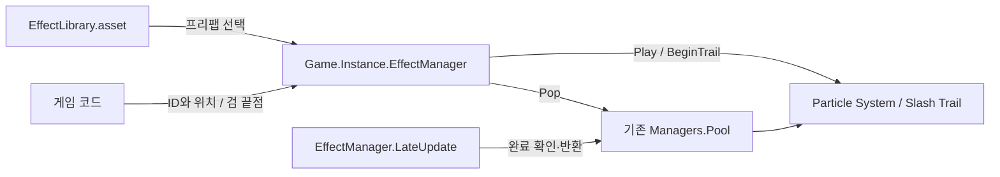

### 이펙트 시스템

- 기능 설명: 검의 SwordEffectEmitter가 베기 구간의 접촉을 감지해 공용 Impact를 자동 재생하고 Trail을 관리한다. 플레이어 담당자는 베기 시작·종료·취소만 연결한다. 대상별 이펙트 호출은 하지 않는다.
- 동작 조건 및 처리 흐름: Game이 Library와 공통 풀을 준비한다. 검의 BeginSwing이 Trail과 접촉 감지를 시작하고 접촉 시 공용 Hit를 요청한다. EffectManager가 단발 완료와 Trail 잔상 종료를 확인해 풀로 반환한다.
- 구현 상태: 검의 시각적 접촉 감지·공용 Hit 자동 재생·Slash Trail·공통 풀 및 세션 관리 구현 완료. EffectTest에서 실제 Collider 접촉·중복 방지·빗나감·자기 충돌 제외·정리와 Windows 빌드를 확인했다. 실제 플레이어 검과 애니메이션 연결은 담당자 영역에 남아 있다.
- 로그 규칙: 안내 및 오류는 SoundManager처럼 영어 Console 메시지로 기록한다.

#### 검 담당자가 알아야 할 기본 사용법

검에 `SwordEffectEmitter`를 붙이고 실제 검 양 끝점과 소유자·감지 레이어를 Inspector에 연결한다. 공격·애니메이션 담당자는 Start 이후 실제 베기 구간에서 다음 세 메서드만 호출한다. EffectId·접촉 위치·Trail 핸들은 전달하지 않는다.

```csharp
// _swordEffects는 실제 검에 붙인 SwordEffectEmitter 참조이다.
bool started = _swordEffects.BeginSwing();
_swordEffects.EndSwing();       // 정상 종료, 남은 Trail은 자연 페이드
_swordEffects.CancelSwing();    // 취소·무기 교체·강제 종료
```

위 예제는 각 호출 시점을 보여준다. 세 메서드를 한꺼번에 실행하지 않는다. BeginSwing은 bool을 반환하므로 Animation Event를 사용할 때는 담당자 수신 메서드에서 호출하고 실패 여부를 확인한다.

| 검 컴포넌트 API | 동작과 반환 |
| --- | --- |
| BeginSwing() | 새 베기의 Trail과 접촉 감지 시작. 성공 bool |
| EndSwing() | 마지막 이동 확인 후 감지·Trail 기록 종료. void |
| CancelSwing() | 감지 중단과 해당 Trail 즉시 정리. void |
| IsSwinging | 현재 베기 감지 여부. bool |

검이 감지 레이어의 Collider에 닿으면 컴포넌트가 내부적으로 `EffectManager.PlayHit(contactPosition)`를 요청한다. 현재 Library의 공용 타격 프리팹은 Impact이며 적·금속·벽·바닥별 효과 선택은 하지 않는다. 같은 Collider에는 베기당 한 번만 재생하고 다음 BeginSwing에서 중복 기록을 초기화한다.

EffectManager·EffectLibrary·EffectId는 내부 생성·풀 관리와 에셋 등록에 유지한다. 아래 서비스 API는 검 컴포넌트와 이펙트 담당자가 사용하는 하위 인터페이스이며 다른 담당자가 접촉점과 ID를 계산해야 한다는 뜻은 아니다.

| 내부 서비스 API | 동작 |
| --- | --- |
| PlayHit(position) | 공용 Impact 단발 요청, 성공 bool |
| Play(id, position[, rotation]) | 등록된 단발 효과 요청, 성공 bool |
| BeginTrail(bladeBase, bladeTip) | Trail 시작, 핸들 / 실패 0 |
| EndTrail(handle) / StopTrail(handle) | 자연 종료 / 즉시 정리, 성공 bool |
| BeginSession() / EndSession() | 전체 효과 세션 관리 |

| ID | 고유 숫자 | 현재 프리팹 |
| --- | --- | --- |
| None | 0 | 재생에 사용하지 않음 |
| BloodHit | 1 | Assets/Resources/Prefabs/Effects/BloodHit.prefab |
| SwordClash | 2 | Assets/Resources/Prefabs/Effects/Impact.prefab, 공용 타격. 기존 enum 이름·숫자는 호환을 위해 유지 |
| SwordSlashTrail | 3 | Assets/Resources/Prefabs/Effects/SwordSlashTrail.prefab |

#### 담당자별 연결과 지원 범위

| 담당자 | 연결할 내용 |
| --- | --- |
| 플레이어의 검·애니메이션 | SwordEffectEmitter 참조와 검 양 끝점·소유자·감지 레이어 설정. 베기 시작·종료·취소 시 세 메서드 호출 |
| 적·금속·벽·바닥 | 실제 접촉을 나타내는 Collider와 감지 레이어. 대상 측 효과 스크립트·ID·위치 요청은 필요 없음 |
| 적 전투·맵 | 기존 피해·가드·사망·파괴 판정 유지. 검의 시각적 접촉 감지를 게임 판정으로 사용하지 않음 |
| UI | 검 이펙트 호출 연결 불필요. Canvas 효과·화면 피격 테두리는 이 서비스 범위 밖 |
| 게임 세션 | 전체 BeginSession·EndSession 관리. 개별 캐릭터가 EndSession을 호출하지 않음 |
| 이펙트 | 검 표현 컴포넌트·프리팹·EffectLibrary 등록과 외형 관리 |

- 대상은 표면 Collider 또는 의도한 피격 Trigger Collider만 제공한다. 감각 범위·상호작용 센서 Trigger는 Contact Layers에서 제외한다.
- 검 컴포넌트 외부에서 같은 접촉의 PlayHit를 다시 호출하지 않는다. 피해 확정 이벤트에서 중복 Hit를 요청하는 구조를 함께 쓰지 않는다.
- 실제 피해·사망은 기존 IPlayerCombatService 등 담당자의 계약으로 확정한다. 검의 시각적 접촉이나 재생 성공 여부는 피해 판정 결과가 아니다.
- BeginSwing은 실제 칼날이 접촉을 표현할 구간에 연결한다. 장착·대기·이동 중에는 감지하지 않는다. 공격 취소·무기 교체에는 CancelSwing을 호출한다. 컴포넌트 비활성화는 자신의 감지와 Trail을 자동 정리한다.
- 플레이어 코드·전투 계약·플레이어 씬은 자동 연결하거나 변경하지 않았다. 실제 검 배치와 애니메이션 수신부 연결은 플레이어 담당자가 수행한다.

#### 새 씬에서 Unity Editor로 환경 구성하기

##### 1. 카메라와 재생 위치 준비

1. 기존 씬·플레이어 카메라가 있으면 해당 구성을 사용한다. 새 씬에서는 Camera를 만들고 표시할 접촉점이 시야 안에 있도록 배치한다.
2. Hit 자체는 Unlit 표현이라 별도 조명이 필수는 아니다. 기존 프로젝트의 URP 설정을 사용하며 새 씬을 위해 렌더 파이프라인 설정을 변경하지 않는다.
3. 실제 검 밑점과 끝점 Transform, 접촉 대상의 Collider를 준비한다. 접촉 지점을 나타내는 빈 Transform이나 대상 측 이펙트 스크립트는 필요 없다.

##### 2. 기존 Library와 매니저 연결 확인

1. Project에서 `Assets/Resources/Effects/EffectLibrary.asset`을 선택한다. Effects의 ID·Prefab·Prewarm Count 연결을 확인한다.
2. `Assets/Resources/Prefabs/GameManagers/EffectManager.prefab`의 Library 필드가 해당 에셋을 가리키는지 확인한다.
3. 기본 환경에서는 매니저를 씬마다 수동 배치하지 않는다. Play Mode에서 `Game.Instance.EffectManager`에 접근하면 기존 Game을 사용하거나 자동 생성하고, Game.Awake가 효과 매니저를 생성한다.
4. 서비스 참조는 호출자 Start 또는 Game.Awake 이후에 가져온다. 씬에 미리 배치한 Game의 Awake보다 다른 컴포넌트 Awake가 먼저 실행될 때 EffectManager가 이미 준비됐다고 가정하지 않는다.
5. 자동 생성 이후에는 Game과 @ActiveEffects가 씬 전환에서도 유지된다. 매 요청마다 새 매니저를 생성하지 않는다.
6. Game은 기존 감각 매니저도 함께 초기화한다. 공유 Game·Managers·리소스 생성 코드는 담당자 합의 없이 변경하지 않는다.

##### 3. 검 컴포넌트 설정과 호출 연결

1. 실제 검 오브젝트에 SwordEffectEmitter를 붙인다. Blade Base·Blade Tip에 검 밑점과 끝점 Transform을 연결한다.
2. Owner Root는 검을 소유한 플레이어 계층의 루트로 지정한다. 이 계층의 Collider는 감지에서 제외된다. 대상과 소유자를 모두 포함하는 씬 전체 루트를 지정하지 않는다.
3. Contact Layers에 적의 실제 피격 Collider·금속·벽·바닥 레이어를 포함하고 감각·UI·상호작용 센서 레이어는 제외한다. Trigger도 이 마스크에 포함하면 감지한다.
4. Contact Radius 기본값은 0.04m다. 높이면 검 주변 접촉 범위가 커지고 시각적 칼날보다 먼저 Hit가 생길 수 있다. Teleport Distance 기본값은 3m다. 이보다 큰 프레임 이동은 이동 경로 감지를 건너뛰고 현재 검 영역만 확인한다.
5. Start 이후 공격 담당자의 수신 메서드에서 BeginSwing·EndSwing·CancelSwing을 연결한다. 기존 BeginTrail·EndTrail도 동시에 호출하면 Trail이 중복되므로 함께 사용하지 않는다.
6. 대상에는 Collider만 있으면 된다. 이 감지는 Physics 쿼리이므로 검의 Rigidbody·OnCollisionEnter·대상 측 이펙트 스크립트는 요구하지 않는다.
7. 검이 비활성화되거나 양 끝점이 파괴·비활성화되면 감지를 취소한다. 다시 활성화했을 때는 새 BeginSwing을 호출한다.

##### 4. 감지 방식과 제한

- LateUpdate에서 검 길이 방향의 다섯 지점이 이전 프레임부터 이동한 구간을 SphereCastNonAlloc으로 확인한다. 현재 검 구간의 cast와 OverlapCapsuleNonAlloc도 사용해 현재 접촉·시작 중첩을 보완한다. EndSwing은 마지막 이동을 한 번 더 확인한다.
- 이동 감지에서는 가장 가까운 외부 접촉의 RaycastHit.point를 사용한다. 현재 중첩에서는 이전·현재 끝점 중 Collider 바깥의 가장 가까운 후보를 ClosestPoint로 투영한다. 모든 후보가 이미 내부에 있다면 내부 위치가 반환될 수 있으므로 깊이 박힌 상태를 정확한 표면 접촉으로 보장하지 않는다.
- 중복 기준은 Collider이다. 한 대상이 여러 Collider를 사용하면 각 Collider에서 한 번씩 생길 수 있다. 대상의 전투 ID로 통합하지 않는다.
- 각 쿼리 버퍼는 32개이다. 꽉 차면 베기당 한 번 경고한다. 감지 레이어를 좁혀 불필요한 Collider를 제외한다.
- 움직이는 대상의 감지는 현재 물리 월드의 Collider 위치를 사용한다. 매 프레임 전역 Physics.SyncTransforms를 호출하지 않는다. 담당자는 물리 업데이트와 애니메이션의 실제 배치에서 확인해야 한다.
- 다섯 지점의 프레임 간 이동은 고정 표본 근사이다. 극단적인 저프레임·빠른 회전의 모든 접촉을 보장하지 않는다. 피해 판정이나 완전한 물리 충돌 해결기로 사용하지 않는다.

#### 이펙트별 윤곽선 선택

- 기본 VFX는 원래 URP 머티리얼로 표시한다. 윤곽선이 필요한 프리팹의 루트에 `BlindBlade.Rendering.OutlineVFX`를 붙이면 그 렌더러와 활성 자식만 적용된다.
- 컴포넌트를 끄거나 제거하면 원래 표현으로 돌아간다. GameObject Layer·원본 머티리얼·EffectId·검 재생 API는 변경하지 않는다. 적용된 효과만 기존 인지 마스크를 따른다.
- 등록·풀 반환 방식은 동일하다. 자세한 렌더링 범위와 설정은 [화면 공간 윤곽선](화면_공간_윤곽선.md)의 VFX별 적용 선택을 참고한다.

#### 현재 효과와 EffectTest

- BloodHit: 선택적으로 재생하는 혈액 피격 효과.
- Impact: 접촉점에 재생하는 공용 Hit. 기존 Impact 프리팹의 입자·재질·Animator는 유지하고 Play On Awake만 꺼 공통 풀에서 재생한다. 접촉 방향이나 대상 재질은 입력받지 않는다. 이전 SwordClash 프리팹은 보존한다.
- SwordSlashTrail: 실제 검 밑점과 끝점의 월드 위치로 궤적 메시를 기록한다. 현재 Library의 해당 ID는 `ProceduralSwordSlashVFX.prefab`에 연결되어 Free Slash VFX의 Slash·Slash World 재질을 절차적 궤적에 표시한다. 기존 먹물 `SwordSlashTrail.prefab`은 별도로 보존한다.
- Trail의 시각적 폭은 검 길이와 Width Scale, 궤적 길이는 실제 움직임과 Lifetime이 결정한다. Width Scale은 접촉 감지나 피해 범위를 늘리지 않는다. 고정 원호를 임의로 생성하지 않는다. 저프레임의 빠른 회전에서는 궤적이 각져 보일 수 있으며 추가 경로 보간은 제공하지 않는다.
- EndTrail은 새 위치 기록만 끝내고 잔상은 자연 종료한다. StopTrail은 잔상까지 즉시 제거한다. Hit는 별도 접촉 요청이 있어야 재생되며 빗나간 베기에 자동 생성되지 않는다.

아래 먹물 설정 표와 먹물 제작 설명은 보존한 기존 `SwordSlashTrail.prefab`에 해당한다. 현재 사용 중인 복사본 설정은 뒤의 ProceduralSwordSlashVFX 항목을 따른다.

| 조정 위치 | 기본값 | 영향 |
| --- | --- | --- |
| SwordSlashTrail의 Lifetime | 0.28초 | 높이면 먹물 궤적이 더 길게 남는다 |
| Width Scale / Maximum Samples | 1.3 / 128 | 시각적 검기 폭과 저장 표본 상한. 접촉 범위는 바뀌지 않음 |
| Pattern Length | 4m | 누적 검 이동 거리에서 붓질 무늬가 차지하는 길이. 값이 크면 무늬가 길게 늘어남 |
| Trail의 Color | 백색, 알파 1 | 흰 검광·잔광의 색과 수명 알파. 먹물 색은 재질에서 별도 설정 |
| SwordSlash 재질의 Ink Color | RGB (0.008, 0.012, 0.018) | 검은 먹물 색 |
| Brush Light / Inner Wash | HDR (1.5, 1.65, 1.8) / (0.55, 0.65, 0.78) | 찢어진 흰 틈과 안쪽 잔광 색 |
| Brush Contrast | 0.95 | 흰 틈의 비율. 무늬는 시간에 따라 이동하지 않음 |
| SwordClash의 Contact Star Lifetime / Size | 0.14초 / 0.95m | 접촉 섬광의 시간과 크기 |

협업자는 위 설정을 변경하지 않아도 API로 사용할 수 있다. 외형 조정은 이펙트 담당자와 합의한다.

먹물 표현은 사용자가 제공한 Eric VFX Studio의 Ink slash Collection(URP) 이미지와 [Unity Game VFX - Ink Sword Slash](https://www.youtube.com/watch?v=vIogr2onCBg)의 미리보기 프레임을 참고해 새로 제작했다. 원본 에셋·텍스처·셰이더 설정은 가져오거나 확인하지 않았다. 원본과 픽셀 단위로 동일한 재현을 보장하지 않으며 실제 애니메이션·카메라·검 길이에 따라 아크 모양은 달라진다.

- SwordSlash 재질만 전용 InkSwordSlash 셰이더로 연결했다. 검은색이 보이도록 SrcAlpha/OneMinusSrcAlpha 합성을 사용한다. 공용 CombatEffect 및 Hit·Blood 외형은 유지한다.
- 붓질 무늬는 셰이더의 연속 노이즈를 길게 늘여 만든다. 생성 표본의 누적 이동 거리로 UV를 고정하고 시간 기반 무늬 이동을 사용하지 않는다. 새 표본 추가·오래된 표본 제거에도 지나간 위치의 무늬는 따라 이동하지 않는다.
- 검은 먹물과 흰 잔광은 모양을 유지하며 각 표본의 잔여 수명에 비례해 알파가 줄어든다. 깎여 없어지는 침식 대신 투명해져 사라진다. EndSwing 이후에도 기존 월드 위치에서 페이드하며, CancelSwing은 즉시 정리한다. 기본 Lifetime은 0.28초이고 Time.timeScale의 영향을 받는다.
- 외부 텍스처·Shader Graph·VFX Graph나 새 패키지는 필요하지 않다. 추가 파티클이나 별도 반환 처리도 없다. Brush Flow Speed·Ink Erosion·Torn Ink Strokes 설정은 제거했다.
- EffectTest의 회색 Ink Slash Backdrop은 기존 먹물 비교용 배경이며 Collider가 없다. 투명 합성 순서상 선택 VFX의 윤곽선을 덮으므로 현재 시연에서는 비활성화했다. 공유 렌더러·감각 코드·프로젝트 설정은 변경하지 않았다.

#### ProceduralSwordSlashVFX

- 원본 `Sword Slash VFX.prefab`을 자식으로 사용하며 Slash·Slash Distortion·Flying의 Particle System·재질·Shader Graph·색상·Custom Data 곡선을 유지한다. 사용자가 제거한 Impact·Smoke는 추가하지 않고, 타격은 별도 Library의 Impact가 처리한다.
- 주 Slash와 왜곡은 원본 메시를 런타임에 복제해 정점 위치만 검 궤적으로 변형한다. 원본 125개 정점·삼각형·UV·정점 색과 안쪽 반경·입체 두께 비율을 유지한다. 실제 렌더링과 셰이더 스트림은 ParticleSystemRenderer가 담당한다. 수동 UV1 구성·UV Inset·Surface Progress·추가 알파 페이드는 제거했다.
- SwordSlashTrail의 띠 메시는 경로 입력으로만 사용하고 루트 MeshRenderer는 숨긴다. 별도 셰이더·VFX Graph·패키지는 추가하지 않는다. Play On Awake·Loop는 끄고 Point Light는 비활성화한다.
- BeginSwing에서 원본 파티클을 초기화한다. 베기 중 주 Slash·왜곡의 원본 시뮬레이션은 Attack Preview Time(기본 0.08초)까지 진행한 뒤 유지한다. 긴 공격 중 단발 효과가 먼저 끝나는 것을 막는 재생 시간 조절이며 곡선 값은 변경하지 않는다. Flying은 실제 프레임 시간으로 진행한다.
- EndSwing은 마지막 경로를 유지한 채 원본 파티클의 나머지 소멸 연출을 재생한다. 모든 입자가 종료되면 풀로 반환한다. CancelSwing은 즉시 입자와 경로를 지운다. BeginSwing·EndSwing·CancelSwing API와 별도 Impact 타격은 유지한다.
- Width Scale=1로 바깥 반경을 실제 칼 길이에 맞춘다. 원본 안쪽 반경 비율을 보존하므로 칼날 전체를 채우는 부채꼴이 아닌 띠 형태다. Attack Preview Time은 베기 중 유지할 원본 연출 시점을 조절한다. Lifetime·Pattern Length는 기존 먹물 Trail 설정이며 이 Native 표현의 수명·무늬를 조절하지 않는다.
- 원본 원호를 늘어나는 경로에 배치하므로 기록 중 무늬가 궤적 길이에 맞춰 변형된다. 기록 종료 후 월드 경로는 유지한다. 저프레임 회전 경로 보간은 없고 극단적으로 긴 공격은 최대 128개 표본 상한의 영향을 받는다.
- 검증: 원본과 같은 0.08초 연출 시점에서 기본 재질을 비교했다. 런타임 메시의 UV·삼각형이 원본과 동일하고 정점 수가 125개임을 확인했다. EffectTest의 베기 중·후반 OutlineVFX 표시와 별도 Impact 재생을 확인했다. 임의의 모든 궤적·카메라에서 픽셀 단위 동일 품질은 보장하지 않는다.
- 수동 Simulate는 방출 기간이 끝나도 대기 상태의 IsAlive가 남을 수 있어, 원본 Duration 종료 시 StopEmitting으로 방출을 종료하고 남은 입자만 끝까지 처리한다. 3초 시뮬레이션 후 IsAlive=false, 실제 베기 후 ActiveEffectCount=0, 재사용 시작 성공과 취소 후 ActiveEffectCount=0을 확인했다. 검증 도구의 Pipeline 시간 초과는 발생했으나 짧은 요청으로 나눠 재검증했다.
- 최종 C# 컴파일·EffectTest Windows 빌드는 오류 0건으로 성공했다. 빌드 경고 16건은 남아 있다. 기존 검 API·Impact 등록·공유 렌더러·ThirdParty 원본 에셋은 유지했다. 임시 비교 오브젝트·카메라·시연 설정 변경은 저장하지 않았다.

`Assets/Scenes/EffectTest.unity`를 열고 Play하면 모형 검을 실제 Collider 대상에 휘두르는 시연을 볼 수 있다. EffectTestSword는 SwordEffectEmitter의 시작·종료·취소를 호출하고 Start에서 씬 전용 `EffectTest Perception Observer`를 SensoryManager.SetObserver로 연결한다. 이 연결이 없으면 OutlineVFX 검기는 생성되어도 인지 영역 밖으로 숨겨진다. 비활성화 시 자신이 연결한 관측자가 여전히 사용 중이면 해제한다. 미리 지정한 Contact Point나 중간 시각의 수동 PlayHit는 없다. 실제 피해 판정은 수행하지 않는다.

1. EffectTest Sword의 Auto Swing을 끄고 컴포넌트 메뉴 `Effects > Swing`으로 한 번 재생한다.
2. Contact Target의 Collider를 비활성화하거나 검 밖으로 이동하면 접촉 Hit 없이 Trail만 확인한다.
3. Swing Duration·Interval·Angle은 시연 검의 속도·대기 시간·회전 범위이다. 실제 플레이어의 공격 설정을 변경하지 않는다.
4. 최종 Collider·끝점 연결은 Edit Mode에서 저장한다. Play Mode의 임시 설정이 저장됐다고 가정하지 않는다.

- 현재 저장된 시연 설정은 Auto Swing=on, Swing Duration=0.45초, Interval=0.9초이다. 관측자는 (0, 0.9, -0.2), 카메라는 (0, 0.75, -5), Orthographic Size=2.15로 검기 전체를 화면 안에 배치한다. 공용 감각 반경·렌더러 설정은 변경하지 않는다.
- 씬 표시 보정 검증: 저장된 씬을 Play해 별도의 관측자·셰이더 전역값 변경 없이 SensoryManager.IsReady=true와 씬 관측자 연결을 확인했다. 자동 베기의 초반 및 중간 Game View 캡처에서 검·접촉 대상·절차적 검기 윤곽선을 확인했다.
- 자동 반복 실행 중 신규 런타임 오류는 없었다. C# 컴파일 및 EffectTest Windows 빌드 오류 0건, 빌드 경고 13건이었다. Play 종료 후 관측자·시연 설정이 저장된 상태와 씬 isDirty=false를 확인했다.

#### 이펙트 담당자의 등록 방법

1. Unity의 Particle System으로 단발 효과 프리팹을 제작한다. 루트에도 Particle System이 있어야 한다.
2. 여러 시스템을 묶을 때는 루트의 표시·방출을 끄고 실제 입자는 자식에 둔다. 매니저는 루트의 Play(true)·Stop(true)·IsAlive(true)로 전체를 처리한다.
3. 루트와 모든 자식의 Loop=off, Play On Awake=off, Stop Action=None을 설정한다. 초기화 검증에서 잘못된 설정이면 거부하며 ID와 시스템 이름을 표시한다.
4. EffectId에 새 이름과 고유 숫자를 추가한다. 이미 저장한 1·2·3을 바꾸거나 재사용하지 않는다. None=0은 재생에 사용하지 않는다.
5. 기존 EffectLibrary.asset의 Effects에 ID·Prefab·Prewarm Count를 등록한다. ID만 추가해도 실제 프리팹 연결이 없으면 재생할 수 없다.
6. None·중복 ID·프리팹 누락·타입 불일치를 확인하고 저장한다. 중복은 임의로 첫 프리팹을 선택하지 않고 거부한다.
7. 협업자에게 사용할 ID와 실제 호출 시점을 전달한다. 단발은 Play, 검 궤적은 BeginTrail을 사용한다.

- 프리팹에 Poolable을 붙일 필요는 없다. 기존 PoolManager가 런타임 풀 객체에 내부 표식을 추가한다.
- 기본 초기 개수는 혈액 3개·Hit 3개·Trail 2개이다. 최대 수가 아니라 준비 개수이며 동시 요청이 많으면 필요한 만큼 늘어난다.
- 입자 수명·크기·속도·색상은 프리팹 Inspector에서 조정한다. 기본 시간은 Time.timeScale의 영향을 받는다.
- 기본 Native 파티클 초기화와 Library 검증은 별도 재생 클래스 없이 수행한다. Trail만 실제 검 폭을 표현하는 메시 생성 스크립트를 사용한다.
- CombatEffect 셰이더는 Blood·Spark·HitRing·HitStar 재질의 원형·링·방사형 섬광을 그린다. SwordSlash는 전용 InkSwordSlash 셰이더를 사용한다. 해당 재질이 참조하므로 사용 중인 셰이더를 삭제하면 렌더링이 깨진다.

#### API의 결과와 제한

- 단발 객체 참조나 재생 핸들은 반환하지 않는다. 단발의 완료와 풀 반환은 매니저가 처리한다.
- Trail은 종료 시점을 호출자가 정해야 하므로 요청 번호만 제공한다. 반환된 번호로 다른 재생을 중단하지 못한다.
- 단발 재생 객체의 이동 추적·개별 정지·재생별 크기/색상·거리 감쇠·자동 중복 제거는 제공하지 않는다.
- 단발은 월드 위치에 남아 자연 종료한다. Sound의 owner 기반 정지와 같은 기능을 자동으로 가정하지 않는다.
- 기록 중 검 끝점 파괴·비활성화는 Trail에만 수명 정리 조건으로 적용한다. 검을 숨겼다가 다시 활성화해도 이전 기록이 자동 재개되지는 않는다.
- 일시정지 시 Time.timeScale=0이면 기본 효과 수명이 진행하지 않는다. 플레이어 행동 상태만 Paused로 바꾸는 것과 구분한다.

#### 세션 수명

- Game 초기화 때 현재 활성 씬의 효과 세션을 시작한다.
- EndSession은 활성 입자를 지우고 모든 추적 효과를 반환하며 새 요청을 차단한다. 반복 호출해도 중복 반환하지 않는다.
- BeginSession은 현재 활성 씬으로 다시 시작한다. 미준비 안내는 준비 상태 구간마다 한 번만 기록한다.
- Single 씬 전환에서는 이전 효과를 정리하고 새 씬에서 시작한다. 관계없는 Additive 씬 로드·언로드는 기존 세션을 유지한다.
- Additive 구성에서 소유 씬을 바꿀 때는 해당 씬을 활성 씬으로 지정한 뒤 BeginSession을 호출한다. 여러 씬별 독립 세션은 지원하지 않는다.
- 활성 객체는 @ActiveEffects, 반환 객체는 @ReusableManagers/@Pool 아래 보관한다. 매니저 비활성화·파괴와 애플리케이션 종료도 정리한다.
- 세션 종료는 전체 게임 담당자가 호출한다. 개별 캐릭터는 자신의 Trail만 StopTrail로 정리하며 다른 서비스의 풀을 Clear하지 않는다.

#### 재생되지 않을 때

| 증상 / Console 메시지 | 확인할 내용 |
| --- | --- |
| Effect session is not ready | Game 초기화, 매니저 활성 상태, EndSession 이후 BeginSession 호출 |
| No prefab registered for EffectId | None·미등록 ID, Library의 해당 Prefab 연결 |
| Duplicate EffectId / EffectId must not be None or duplicated | Library의 ID 중복·None 항목 |
| Prefab is not assigned for EffectId | 해당 항목의 빈 Prefab 필드 |
| Effect component does not match the ID | 단발은 루트 Particle System, Trail ID는 SwordSlashTrail |
| Set Loop off, Play On Awake off and Stop Action None | 메시지의 ID/시스템 이름에 해당하는 프리팹 설정 |
| Use BeginTrail for sword trails | Trail에 Play를 사용했는지 확인 |
| BeginTrail requires active blade endpoints | 검 양 끝점 참조·활성 상태 |
| 성공했지만 보이지 않음 | 카메라 시야·레이어·위치, 입자 방출과 렌더러, 재질·알파·크기 |
| Trail이 길게 남음 | 베기 종료 콜백에서 EndTrail, 취소 시 StopTrail을 호출했는지 확인 |

구성이 정상이어도 실제 호출 코드가 없으면 재생되지 않는다. 재생 확인은 실제 충돌/애니메이션 호출부에서 수행한다. 원형 Hit를 위해 법선·입사각 계산을 다시 추가할 필요는 없다.

#### 관련 코드

| 경로 | 클래스 / 메서드 | 역할 |
| --- | --- | --- |
| Assets/Scripts/Effects/SwordEffectEmitter.cs | BeginSwing, EndSwing, CancelSwing | 검의 시각적 접촉 감지·공용 Hit·Trail 요청 |
| Assets/Scripts/Effects/ProceduralSwordSlashVFX.cs | Begin, Tick, ApplyAppearance, Clear | 원본 파티클 시뮬레이션·원호 정점 변형·정리 |
| Assets/Scripts/GameManagers/EffectManager.cs | PlayHit, Play, BeginTrail, EndTrail, StopTrail, BeginSession, EndSession | 공통 요청·완료·풀 반환 |
| Assets/Scripts/Effects/EffectLibrary.cs | PreparePools, TryGetPrefab | 등록·검증·프리팹 조회 |
| Assets/Scripts/Enums/EffectId.cs | EffectId | 고정된 재생 ID |
| Assets/Scripts/Effects/SwordSlashTrail.cs | SwordSlashTrail / BeginTrail, EndTrail, ReleaseBlade | 검 이동 기록·잔상·참조 정리 |
| Assets/Scripts/Effects/EffectTestSword.cs | Swing, Update | EffectTest의 모형 검 시연, 실제 전투 판정 없음 |
| Assets/Scripts/GameManagers/Game.cs | Awake, EffectManager | 생성·접근점 |
| Assets/Resources/Effects/EffectLibrary.asset | EffectLibrary | 기존 프리팹 등록 |
| Assets/Resources/Prefabs/GameManagers/EffectManager.prefab | EffectManager | Library 연결 |
| Assets/Effects/Shaders/CombatEffect.shader | BlindBlade/CombatEffect | 표시용 URP 셰이더 |
| Assets/Effects/Shaders/InkSwordSlash.shader | BlindBlade/InkSwordSlash | 검은 붓질·백색 틈·잔광·먹물 소멸 |

매니저 Resources 호출 경로는 `GameManagers/EffectManager`이며 ResourceManager가 Prefabs/를 붙인다. 실제 프리팹은 Resources/Prefabs/GameManagers에 있다. Library는 이 프리팹의 참조로 연결하며 씬마다 복제하지 않는다.

#### 내부 구조



- ID·Library·공통 매니저·내부 수명 관리는 SoundSystem과 같은 책임 분리이다.
- SoundManager는 일반 C# 서비스라 Managers.Update가 호출하고, EffectManager는 MonoBehaviour라 Unity가 LateUpdate를 호출한다.
- 단발은 Unity의 실제 완료 상태를 읽는다. 효과별 수명 스크립트나 별도 고정 타이머는 없다.
- 활성 기록은 private readonly struct로 보관해 요청마다 추적용 class 객체를 만들지 않는다. 실제 성능 수치는 별도 측정하지 않았다.
- Game/Managers·사운드·플레이어·적·발자국 코드는 이번 보완에서 변경하지 않는다.

#### 연결 및 협업

- 이펙트 담당자는 검 접촉 표현·프리팹·Library·서비스를 관리한다. 검 담당자는 끝점·레이어·베기 구간만 연결하며 접촉점·ID는 전달하지 않는다.
- 애니메이션 담당자는 검 끝점과 시작·종료 수신 메서드를 연결한다. 실제 자동 연결은 아직 구현하지 않았다.
- 검 접촉 Hit의 요청 주체는 SwordEffectEmitter 하나다. 대상 측 피격 효과 요청과 병행하지 않는다. 피해·가드·소리 판정은 각 담당자의 기존 계약을 유지한다.
- 발자국·파동·빛은 기존 SensoryManager 영역이다.
- 실사용 3종 프리팹과 기존 호출 계약을 유지한다. 강화 작업은 SwordSlashTrail·관련 셰이더와 재질·EffectTest 시연에 한정한다. 삭제된 AgentScripts·Preview 폴더와 시연 씬은 다시 만들지 않는다.
- 협업자용 이펙트 문서는 이 파일 하나로 유지한다. 사용자가 삭제한 별도 전투 이펙트 제작 문서는 복원하지 않는다.
- 승인 필요 사항 및 결과: 사용자가 검의 접촉 감지 기반 자동 Hit를 요청했다. 이펙트 영역의 SwordEffectEmitter·EffectTestSword·EffectTest 씬과 이 문서만 변경했다. 다른 담당자의 코드·씬·기존 전투 계약과 공통 매니저는 변경하지 않았다.

#### 임포트한 Free Slash VFX 호환성

Free Slash VFX는 MaykerStudio의 별도 데모·프리팹 묶음이다. ThirdParty 원본은 기존 SwordEffectEmitter·EffectLibrary와 자동으로 연결하지 않는다. 현재는 Resources의 `ProceduralSwordSlashVFX` 복사본을 절차적 Trail로 변형해 Library에 연결했다. 원본 Shader Graph·텍스처·프리팹은 유지한다.

- Multiple Slashes 프리팹의 Slash Cracks Renderer에 빠진 머티리얼을 같은 팩의 정상 Multiple Impact 구성을 기준으로 Crack Decal에 연결했다.
- Slash Eletric VFX의 Flying은 Render Mode=None이고 별도 Trail 머티리얼로 표시한다. 이곳의 빈 첫 슬롯은 의도된 구성이라 변경하지 않았다. 실제 입자를 표시하는 렌더러의 머티리얼 누락은 수정 후 0건이다.
- ElementsShowCase의 코루틴은 초기 참조가 null인 상태에서도 시작되고 반복 재생한다. 재시작 시 이전 코루틴을 정리하고 비활성화 시 중단한다. AttackerController는 Looping 토글의 초기 상태도 반영한다.
- CameraOrbit의 새 Input System 분기에서 Mouse.delta를 사용한다. 기존 Input.GetAxis는 구형 입력 분기에만 남겨 입력 백엔드 혼용 오류를 제거했다. 픽셀 이동은 Rotation Speed에 0.05를 곱해 각도로 환산한다.
- ParticleAnimationEvent는 설정한 particleContainer에서 현재 선택한 효과를 찾는다. 빈 컨테이너는 투사체 요청으로 잘못 처리하지 않는다. Projectile은 발사 후 잔상까지 종료되면 자신을 제거하며, 발사 전 데모용 미리보기는 유지한다.

에셋팩 데모 씬은 현재 공용 PC_Renderer의 Screen Space Outline·감각 마스크 때문에 검게 보인다. 이것은 머티리얼의 URP 변환 오류가 아니다. 임시 비교 캡처에서는 해당 패스를 제외했을 때 모델·바닥·효과 색상을 확인했으나, 이 임시 카메라 타입 변경은 URP 처리와 충돌해 복원했다. 씬이나 공유 설정에 저장하지 않았다.

원래 데모 표현을 복구할 제안은 Assets/Settings/PC_RPAsset.asset의 Renderer List에 팩의 Demo/Config/URP-Renderer.asset을 두 번째 항목으로 추가하고, 팩의 SampleScene 카메라만 그 렌더러를 선택하게 하는 것이다. 게임의 기본 렌더러는 기존 0번을 유지한다. 공유 설정과 다른 작업자 영역에 연결되므로 승인 전에는 실행하지 않는다.

검증: 컴파일 및 데모 Windows 빌드 오류 0건. 정상 게임 카메라의 새 세션에서 반복 재생이 3.2초 시점의 정지 상태에서 3.9초 시점의 재생 상태로 다시 전환됐다. 짧은 거리로 발사한 임시 투사체는 잔상 종료 후 제거됐다. 합성 마우스 입력에서도 CameraOrbit 회전과 예외 없음이 확인됐다. 최종 세션의 새 Console 오류는 없었다. 원본 그래프의 pow 관련 경고와 기존 공용 렌더러 경고는 남아 있으며, 데모의 기본 화면 복구는 위 설정 승인 대기다.

#### 검증 결과와 남은 통합 점검

- 기존 EffectTest 점검에서 Hit·Trail 정상 재생, 자연 종료·풀 반환·동일 객체 재사용·StopTrail·세션 종료를 확인했다. 미등록 ID·잘못된 요청·비활성 검 끝점 안내와 세션 재시작도 확인했다.
- 보조 잔광 제거 후 컴파일 성공, Trail 프리팹 Particle System 0·Missing Script 0을 확인했다. 메시가 생성됐고 자연 종료 후 active=false·IsPlaying=false·정점 0으로 반환됐다.
- 검 자동 접촉 구현 후 EffectTest의 Windows 빌드가 오류 0건·경고 1건으로 성공했다. 경고는 RuntimePipelineConfig가 없어 Player에서 Pipeline 도구를 비활성화한다는 기존 안내다. 빌드 실행 파일의 별도 플레이는 수행하지 않았다.
- 실제 플레이어·적의 애니메이션과 피해 판정 연결, 게임 카메라의 시야 가림·밝기, 대량 동시 재생 성능은 미확인이다. 기존 Unity 내부 allocator 경고의 원인도 미확인이다.
- 검 자동 접촉 구현 후 컴파일 성공. EffectTest의 BoxCollider 접촉에서 Trail+Hit 2개, 동일 접촉 유지 중 Hit 종료 후 Trail 1개·중복 기록 1개를 확인했다. Hit 위치는 (0.27, 1.27, -0.17)로 대상의 표면에 있었다.
- 대상 Collider를 끄고 자기 검 계층에 Collider를 추가한 베기는 접촉 기록 0·Trail만 재생됐다. CancelSwing 이후 활성 효과 0을 확인했다. Trigger 대상의 접촉 기록 1, EndSession 이후 활성 효과 0도 확인했다. 임시 Collider 설정은 씬에 저장하지 않았다.
- 마지막 검 이동을 같은 호출에서 만든 뒤 EndSwing을 실행했을 때 Trail+Hit 2개·IsSwinging=false였고 자연 종료 후 활성 효과 0이었다. 단순 시연에서는 Rigidbody나 대상 측 이펙트 스크립트를 사용하지 않았다.
- 남은 통합 점검: 플레이어 담당자가 실제 검에 컴포넌트를 붙이고 애니메이션의 베기 시작·정상 종료·취소와 연결한다. 실제 검·적 Collider의 레이어, 자기 소유자 제외, 비활성화·씬 전환, 저프레임 회전을 확인한다. 피해 확정 이벤트에서 같은 Hit를 다시 요청하지 않는다.
- 최종 EffectTest Missing Script 0·저장 완료를 확인했다. 임시 Trigger·자기 Collider는 저장되지 않았다. 변경 전후 해시 비교에서 기존 149개 파일이 같았으며 플레이어·적·맵·UI·사운드 코드, 다른 씬·Library·공통 매니저·이펙트 외형 에셋은 보존했다.
- 초기 먹물 스타일에서 붓질·흰 틈·안쪽 잔광·가는 획을 확인했다. 이후 사용자 요청으로 검끝의 가는 보조 획을 제거하고 무늬 이동·침식을 고정 위치의 투명도 페이드로 변경했다.
- 먹물 Trail+기존 접촉 Hit가 활성 효과 2개로 재생됐고, 자연 종료 후 0개였다. 같은 Trail 인스턴스 재사용과 CancelSwing 후 활성 효과 0도 확인했다. 검 접촉 감지 컴포넌트와 기존 재생 API는 변경하지 않았다.
- 최종 먹물 구현의 Windows 빌드는 오류 0건·기존 Pipeline 안내 1건으로 성공했다. 첫 빌드 중 보낸 에디터 검사 요청의 시간 초과가 보고서에 오류로 집계되어, 추가 요청 없이 다시 빌드해 오류 0건을 확인했다. 기존 화면 윤곽선 셰이더의 초기 빌드 경고는 다른 담당자 영역이므로 수정하지 않았다.
- 초기 먹물 변경의 화면 기록은 Temp/InkSlashReference/preview.png이며, 보조 획 제거 이전 이미지다. 실제 원본과의 픽셀 일치·전체 영상 재생·대량 동시 재생 GPU 비용은 검증하지 않았다.
- 고정 위치 페이드 점검에서 새 구간 추가 전후 메시 정점이 4→6으로 증가해도 기존 표본의 위치·UV가 같았다. 종료 후 검을 회전시켜도 위치·UV는 유지됐으며 약 0.104초 동안 알파가 1→0.629로 줄었다. 이후 활성 효과 0으로 반환됐다.
- 최종 먹물 셰이더 메시지 0건, Windows 빌드 오류 0건으로 성공했다. 경고 2건은 기존 Pipeline 설정 안내와 화면 윤곽선 셰이더의 EdgeBetween 초기화 안내이며 다른 담당자 영역은 수정하지 않았다. 이번 변경은 SwordSlashTrail 코드·프리팹·먹물 셰이더·SwordSlash 재질·이 문서에 한정된다. 검 접촉 감지·Hit·씬·공유 렌더러 설정은 유지했다.
